# Make a full-size mai controller
A complete record of building a mai controller at home

如果你想看中文版的教學去[README.md](README.md)

You're reading: English, Claude Code translation version

> ⚠️ **Read this first (Disclaimer):**
> - This project is a personal DIY record. It is not affiliated with SEGA or any official operator and has not been endorsed by them; the relevant names and trademarks belong to their respective owners. This guide does not provide, and does not help you obtain, any game files or cracks. It only covers the controller hardware and firmware.
> - The build involves mains power, heavy parts, tempered glass and power tools, so there is a real risk of injury, property damage and equipment damage. **You follow it entirely at your own risk, and the author takes no responsibility for the build process or any outcome.**
> - See the full [Disclaimer and License](DISCLAIMER.md). The text and photos are licensed under [CC BY-NC-SA 4.0](LICENSE), except for third-party content.

Before anything else, here's a picture of the finished build
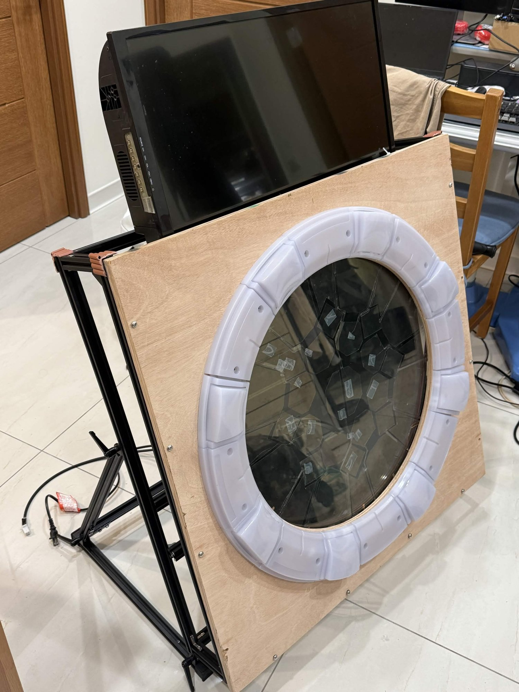

<!-- TOC -->
<details open>
<summary><b>Table of Contents</b></summary>

- [References](#references)
- [Device Design](#device-design)
  - [Overview](#overview)
  - [Screen and Touch](#screen-and-touch)
  - [Outer Ring](#outer-ring)
  - [Front Panel](#front-panel)
  - [Frame](#frame)
  - [Circuitry and Firmware](#circuitry-and-firmware)
  - [Summary](#summary)
  - [Design Drawings](#design-drawings)
- [Parts List](#parts-list)
- [Build Log](#build-log)
  - [2026/8/16 Ordering materials](#2026816-ordering-materials)
  - [2026/8/18 Buying the TV](#2026818-buying-the-tv)
  - [2026/8/19 The aluminum extrusion arrives](#2026819-the-aluminum-extrusion-arrives)
  - [2026/8/21 Mounting the TV on the frame](#2026821-mounting-the-tv-on-the-frame)
  - [2026/8/23 Glass](#2026823-glass)
  - [2026/8/24 ???](#2026824-)
  - [2026/8/26 Delivery day](#2026826-delivery-day)
  - [2026/8/27 Buying the plywood, ITO...](#2026827-buying-the-plywood-ito)
  - [2026/8/29 Inner ring wiring done, and also...](#2026829-inner-ring-wiring-done-and-also)
  - [2026/8/30 Barbecue at Mobe's place 😴](#2026830-barbecue-at-mobes-place-)
  - [2026/8/31 Front panel assembly](#2026831-front-panel-assembly)
  - [2025/9/1 I feel like you don't really care about me as a friend](#202591-i-feel-like-you-dont-really-care-about-me-as-a-friend)
  - [2026/9/1 Wiring the buttons](#202691-wiring-the-buttons)
  - [2026/9/2 Making the main board](#202692-making-the-main-board)
  - [2026/9/3 Firmware and device debugging](#202693-firmware-and-device-debugging)
    - [Firmware Walkthrough](#firmware-walkthrough)
    - [Problems I ran into while debugging](#problems-i-ran-into-while-debugging)
  - [2026/9/4 Inner ring repair, bezel installation, frame installation](#202694-inner-ring-repair-bezel-installation-frame-installation)
  - [2026/9/5 Angled braces installed, done](#202695-angled-braces-installed-done)
- [Conclusion](#conclusion)
- [Acknowledgments](#acknowledgments)

</details>
<!-- /TOC -->
Let me give the conclusion up front:

- Total cost is about NT$20,000, including the cabinet's own materials plus the tools and equipment used. The cabinet's own cost is about NT$16,767
- Time spent: 2026/8/16–9/5, about three weeks, from ordering materials through assembly and debugging
- I recommend having another person available to help at any time
- Very strong hands-on skills are required
- Poor workmanship (mine): **touch is prone to problems (ghost touches)**, and I forgot to adjust the button spring leaves, so **tapping too lightly won't register**
- If you just want to play at home, order a ready-made controller instead: NT$30,000 to 50,000, and the quality and results are certainly 100 times better than handmade
- **If you have enough of a maker spirit, then keep reading!**

This article is a bit messy, but as long as you read it all the way through, in theory you should be able to learn how to assemble the entire controller. Of course, if anything isn't explained clearly, feel free to ask in the issues, or DM me directly on IG: [@e04._.40e](https://www.instagram.com/e04._.40e/)

But to be upfront, I won't publicly answer game-related questions

# References
First, the design of the cabinet itself. The overall frame and the choice of materials are based on the following sources:
- https://github.com/Syndric/maimai-controller-fullsize The entry point of the whole GitHub project
- https://docs.google.com/document/d/1rlUKWXb57IGA04_7nuOs167HQMNG2UHoSkpQwI1rv1U/edit?usp=sharing A document the author above linked on GitHub, with more detailed build steps and a parts list
- https://cad.onshape.com/documents/0de9fedbf647e37c2995b7f4/w/1d45f7dfa4ad59765e1a4e80/e/e38d63b666de5499eb63b129 The 3D model of the controller, by the same author
- https://github.com/ir0nq/maimai-homemade-controller This project is mentioned by the first GitHub repo above, and is also worth consulting for materials
- 【【教程】如何在家制备一台萌萌的音游游戏机第二期（材料准备）】 https://www.bilibili.com/video/BV1w12zYzEza/ (Chinese: "[Tutorial] How to build a cute rhythm game machine at home, Part 2 (Preparing materials)")
Besides this one there are plenty of similar videos on Bilibili; they're basically a Chinese-language walkthrough of the materials and the principles.

Next, the firmware
- https://github.com/whowechina/mai_pico This project is built on top of this repo
- https://github.com/samuelhsieh0829/mai_pico The hardware used in the other articles I followed is different from the original mai_pico, so I had Codex modify the code for me. More details below.

Finally, touch sensing
- https://github.com/NaiXi2233/dkmaiproj/blob/main/tn/2.md This article covers maimai's touch technology in great detail. I recommend that everyone who wants to build a controller read it at least once.

I may link to some of these references again inline later on. I suggest reading them alongside what I wrote, in case I missed anything. I'd also like to thank all the senpai above for their detailed ~~pitfall-hunting~~ records, which let me finish this build successfully 🛐🛐🛐

# Device Design
## Overview
Before building a maimai, we first need to understand what parts it is made of:
- The outer ring: the eight buttons, plus the decorative bezels between the buttons
- The inner ring, or that "touch screen"
- The front panel, which holds the outer and inner rings in place and bolts the whole thing onto the frame
- The frame, which supports the front panel and the "display panel"
- The circuitry and firmware, which receive the signals from the inner and outer rings and send them to the computer

## Screen and Touch
I think a lot of people (okay, at least I used to) assume the middle of maimai is just a touchscreen like a phone's. But have you noticed that touch on the cabinet doesn't seem all that responsive? For example, on the song select screen you can swipe left and right to jump several songs at once, but the swipe seems to need to be pretty big before it registers.

Right: maimai's screen is actually made up of the "display panel" and the "touch screen" mentioned above. The "display panel" is really just a **43-inch computer monitor/TV** mounted upright on the frame. What you see on the cabinet as the top screen and the middle screen are both shown on this one display.

So what's the "touch screen"? It's a sheet of glass with a transparent conductive material, **ITO**, attached to a piece of **tempered glass** in separate zones. In the settings page you enter after picking a song and before the game starts, there's a theme called "sensor", which uses the screen to visualize these transparent zones. (Captured from https://maimai.fandom.com/zh/wiki/%E9%81%8A%E6%88%B2%E7%B0%A1%E4%BB%8B?variant=zh-hans)

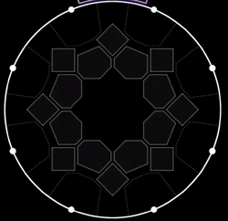It looks roughly like this

So essentially, maimai's screen is an ordinary monitor in the back, with glass and sensors placed in front of it to pick up your touches.

Then how do the glass and ITO read touch signals? It works on the principle of an "RC filter circuit". When a hand touches the glass whose back side has ITO attached, a capacitance is formed. The ITO is connected to an mpr121 through copper wire, and the mpr121 module keeps charging and discharging the ITO. Because of your hand, the charge/discharge time the mpr121 sees changes, and that's how it recognizes the touched state. (I may not have explained the principle very clearly; if you're interested, look it up online.) (Image captured from [this link](https://www.google.com/imgres?q=rc%E6%BF%BE%E6%B3%A2%E9%9B%BB%E8%B7%AF%20%E8%A7%B8%E6%8E%A7&imgurl=https%3A%2F%2Fmiro.medium.com%2Fv2%2Fresize%3Afit%3A774%2F1*9osAFOQgx3IhJ586Dg0XQA.png&imgrefurl=https%3A%2F%2Fmedium.com%2F%40acamvproducingstudio%2Frc-%25E4%25BD%258E%25E9%2580%259A%25E6%25BF%25BE%25E6%25B3%25A2%25E9%259B%25BB%25E8%25B7%25AF%25E8%2588%2587%25E5%2585%2585%25E6%2594%25BE%25E9%259B%25BB%25E7%2589%25B9%25E6%2580%25A7%25E8%25A9%25B3%25E8%25A7%25A3-23ba8c7a9968&docid=OgYoWU5xlPDJ3M&tbnid=uf900lkKKjS_EM&vet=12ahUKEwiXnanx0KyXAxWihq8BHZF3PFkQnPAOegUIiQIQAA..i&w=387&h=182&hcb=2&ved=2ahUKEwiXnanx0KyXAxWihq8BHZF3PFkQnPAOegUIiQIQAA))
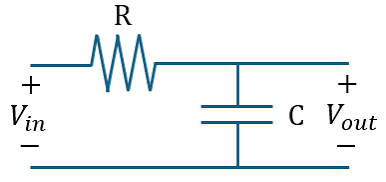

So in short: tape a wire onto the ITO, connect the other end of the wire to a touch pad on the mpr121, and it works (yes, very concise).

Now the ITO specs. **Be sure to buy the kind with adhesive backing**, since I heard it's very hard to work with otherwise. For size, I suggest simply looking for one listed as one square meter, so that if you cut something wrong you still have room to redo it. Another spec is the "sheet resistance" (ohms per square, written as Ω/sq). I picked 40 ohms. I heard the higher it is the more transparent it is, but the sensitivity may be lower. ~~If you have no idea, just buy the same one as me~~ I randomly picked one on Taobao for CNY 210, about NT$1,100 including shipping. If you don't want to use that kind of platform, Shopee also has A4-size options, but at a much higher price, so decide for yourself.

Lastly, how to wire up the ITO. There are two ways. One is to cut out small shapes and connect them to the mpr121 with 0.13 mm enameled wire. Sand both ends of the wire, then tape one end onto the ITO with clear tape. **Note!!! The tape area must not be too large, otherwise "parasitic capacitance" can easily appear and break the pressed state.** Solder the other end to the mpr121. The advantages are that it's convenient and very stable; the downside is that it's a bit ugly, since the wire isn't transparent. To quote a saying: ~~but while you're playing you can't even see which way the slide stars are going, who has time to care about this~~

The other way is to cut the ITO into shapes that carry their own lead, run the lead out to the edge, and then attach copper foil tape there and solder any wire from it to the mpr121. The advantage is that the screen looks very clean. But if a lead is cut slightly crooked and overlaps another zone, or is cut too thin, or gets accidentally scratched through the middle and breaks the circuit, that zone can become very unstable. I originally used this method, but zones B and E were just too hard to get right, so in the end I cut off all the ITO leads and switched to enameled wire qq.

There are actually two other ways to do the ITO. One is etching: using chemical processes to pattern it directly onto the glass, which in theory leaves no visible traces at all. If your budget is generous you can look for a fabrication service online (as I recall, a piece of glass like this costs NT$5,000 without shipping). The other is my own idea: stick a huge sheet of ITO directly onto the glass and then divide the zones with a knife, which in theory avoids the problem of cutting inaccurately. In practice, though, air bubbles show up very easily and are hard to deal with. If you have three or four people to do it together, feel free to try it and report back.

The shapes to cut the ITO into are [here (Syndric/maimai-controller-fullsize)](https://github.com/Syndric/maimai-controller-fullsize/blob/12a12d8874ba55f19a7bfe75ee2fa238b4887faa/dxf/mai_pico_a4.zip). Print each shape out on several sheets of A4, cut them out, place the ITO on top, and cut along them.

(Btw, only while writing this did I realize I never took separate photos of the above. Please look through the references I gave, especially [this one (NaiXi2233/dkmaiproj)](https://github.com/NaiXi2233/dkmaiproj/blob/main/tn/2.md), which is 100 times more detailed than me and has even more tips for avoiding pitfalls.)

One more note: maimai has 34 touch zones in total. They are zone A, A1~A8, under the outer-ring buttons; zone B, B1~B8, just inside zone A; C1 and C2 in the very center, split left and right; zone D, D1~D8, in the middle of each A zone; and zone E, E1~E8, each enclosed by two B zones, two A zones and one D zone. For the exact positions, see the picture below. (Captured from [this link](https://www.google.com/imgres?q=maimai%20sensor&imgurl=https%3A%2F%2Feurope1.discourse-cdn.com%2Farduino%2Foriginal%2F4X%2F3%2Fa%2F7%2F3a7dcf6d3bb8a0bb407de4800a575e857dd24939.jpeg&imgrefurl=https%3A%2F%2Fforum.arduino.cc%2Ft%2Fbest-way-to-make-a-touch-screen-monitor%2F1025206&docid=csgjWrF-ePKZHM&tbnid=Il1OGcMSc33dKM&vet=12ahUKEwjxxonJ0KyXAxVwslYBHaoxFMkQnPAOegUI9gEQAA..i&w=1066&h=1062&hcb=2&ved=2ahUKEwjxxonJ0KyXAxVwslYBHaoxFMkQnPAOegUI9gEQAA))


## Outer Ring
There are two ways to make the outer ring. One is to 3D print it yourself, but I can't do 3D modeling, so you'll have to look for other resources. The second is to buy them ready-made. They're really expensive, but convenient. Eight buttons cost CNY 720, plus eight decorative bezels for CNY 180. That should be the baseline, and might even be the budget version. I heard there's a kind of "rabbit button" with a better feel, but at over NT$700 each I really couldn't bring myself to buy it.

Let's talk about how the buttons work. It's very much like an optical switch: inside there's a metal spring leaf that bends when pressed and springs back when released. When pressed, part of the leaf blocks the photo eye. Imagine an infrared laser constantly shining into a person's eye (the photo eye); when something blocks the path between the two, the person reacts and sends back a "pressed" signal (a high level).

A button has three pins: VCC, GND, and OUTPUT. VCC and GND power the infrared emitter and the photo eye, and OUTPUT changes state according to the signal received (pressed or released).

Also, the button's signal has to go through a pull-up resistor. I've forgotten the exact reasoning, but anyway, a resistor of about 5.1K needs to be placed in front of OUTPUT to stabilize the signal, roughly like this:
```
3.3V->5.1k->output->(button IC)->GND
        |-GPIO
```

Now for something bizarre: you may not be able to trust the wire colors. First, once you get the buttons, each comes with a cable attached, and you'll need to buy additional cable to connect to it and run it to the circuit board. The connectors on this cable are keyed, but ~~whatever lunatic made this~~ the three pins are wired in the order red-black-yellow, while the photo eye's order is GND, OUTPUT, VCC. Since the orders differ, the red wire may actually be GND. Anyway, pay special attention to this. You can test with the diode mode of a multimeter: pick two pins and assume they're VCC and GND, power it up, then use the meter to find the assumed GND and the other pin, OUTPUT. If the meter beeps when you press the button, the positions are confirmed. Btw, on my buttons OUTPUT is the middle pin; yours might be the same.

Next, the button lighting. The buttons I bought have no built-in lighting, so you need to buy WS2812 LED strips yourself. I used 60 LEDs per meter, with 4 LEDs per button, but actually 15 or 30 per meter should be enough. Count one or two LEDs per button, otherwise the power draw might get so high that you need a separate power supply (like me). Of course, more LEDs will also be brighter, so decide for yourself. The LED count is 8 × (1~4), depending on how many you put in.

Speaking of LEDs: the Aime scanner and the cabinet itself have lighting too, but I didn't build those this time.

Back to the button itself. Besides the photo eye and the spring leaf, there's also a base, a top cover, a button cap, a stem, and other parts. What I want to point out is the base and the top cover: everything except the top cover is attached to the base. The base has four holes so it can be screwed onto the front panel, while the top cover is held onto the base by four other small screws. Basically, to service a button you don't need to touch the base at all, you just lift off the top cover.

~~I originally meant to write the following paragraph elsewhere, but I found that some content below assumes you've read it, and putting it any lower would leave parts confusing, so I moved it up here. It may not connect smoothly with the text above, sorry.~~ Anyway, these are the things to do first after you get the buttons.

One reason to take a whole button apart is to adjust the spring leaf. Otherwise, like me, light taps on the button won't register. There's a tutorial on Bilibili; I forgot the link, but the one with a girlfriend helping on the side should be the right one.

Besides adjusting the spring leaf, some buttons apparently don't come with the wires plugged in for you, so basically you need to take every button apart first. Remember to have a hex screwdriver ready, since the screws you get may be this kind. After opening all eight buttons, plug in the cable they gave you (you say you don't have cables? Go to Guanghua Digital Plaza and look for those super small 3P ones and you should be fine). Then comes the LED strip: you need to take the button apart, stick the strip on, and solder wires to it. I recommend, like me, finding eight sets of male + female connector wires. The WS2812's data pin has two directions, IN and OUT. You could solder male connector wires to all the OUTs and female ones to all the INs, so that once all the buttons are installed on the panel you can just chain them together.

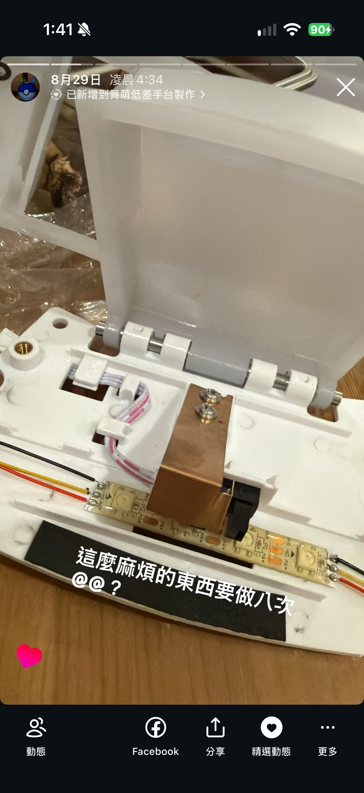 Yes, here's the only photo I could find with a button opened up. I was even working on this in the small hours of my birthday 😱😱😱

## Front Panel
This is the layer that has to support a lot of things. It needs a round hole in the middle, holes drilled in the front to install the buttons, a recess dug in the back to seat the glass, and edges that bolt to the frame. Approaches I've seen use aluminum plates, some kind of plastic board (not sure, it feels like it would get smashed), and wooden boards (plywood), which is what I chose.

Wood is a pretty convenient option. You can just go to the woodworking shops on Xizang Road in Taipei's Zhongzheng District (or was it Wanhua District) and have one made to order. There are also some on Tingzhou Road. Just pick one at random. Cutting the wood into a square and making two circles in the middle isn't hard for them, but I still spent NT$2,000, since I don't know much about woodworking. If you do, tell me whether that's a reasonable price.

Before ordering, you need to know the overall dimensions. The diameter of the inner-ring screen is 52 cm. If you use circular glass, leave about 3 cm of extra room on each side around the outer edge to sit in the plywood's recess. So I ordered a **580 mm diameter, 5 mm thick round tempered glass**. On the plywood, **right in the center**, there's a **583 mm diameter recess, 5.5 mm deep**, and a **520 mm diameter hole**. The outer ring itself is 70 cm wide, so I ordered an 80 × 80 cm square plywood sheet, 1.7 cm thick. (You can go smaller, but space gets tighter. Personally I think the plywood could be thinner. This thickness noticeably increases the vertical gap between the outer ring and the screen, making it easier for your hand to hit the edges of the outer ring. But if you change the thickness, remember to change the screw lengths too.)

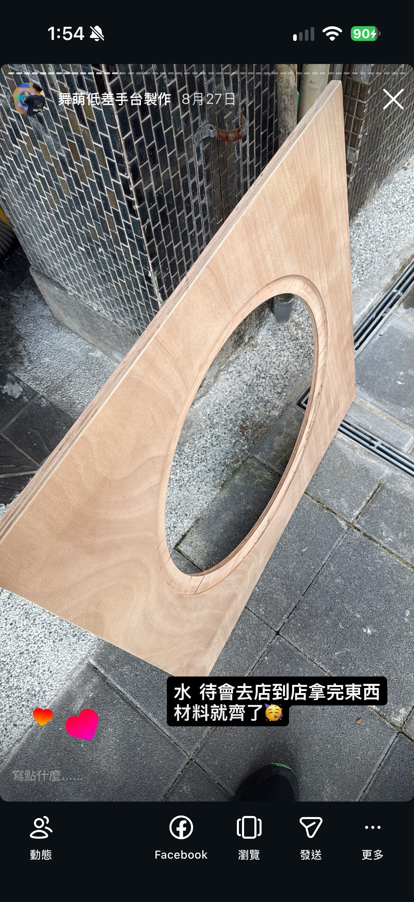 Cut like this

Next, how everything is fixed onto it. For the buttons I used wood self-tapping screws, the kind with a pointed tip, and screwed the buttons straight into the plywood, since the button bases never need to come off anyway. For the bezels, first drill holes (in the middle of each side of every button base there's a semicircular notch, which is space reserved for the bezel screw; drill at the position of that notch), press in a screw sleeve, then fasten the bezel with the screw that matches the sleeve.

As for the so-called screw sleeve, I expected something like a brass standoff that can tap itself into the wood and bring its own thread, but I really couldn't find one, or they were all too thin (they're all M3, but the bezel's hole is M5). In the end I found something that looked similar at Xiaobei (a Taiwanese hardware/variety store chain) and installed it. But the design of that sleeve also means I can no longer open the buttons' top covers, so it's not a good design.

## Frame
The frame has to support the whole device. I basically copied [this, yes, the 3D model from earlier](https://cad.onshape.com/documents/0de9fedbf647e37c2995b7f4/w/1d45f7dfa4ad59765e1a4e80/e/e38d63b666de5499eb63b129). It uses 2020 aluminum extrusion (meaning 20 mm × 20 mm in cross-section), a very cheap material at about NT$15 per 10 cm. I used 1,080 cm in total. The nice thing about aluminum extrusion is that all four sides have slots for fastening. The specific methods are slide-in or drop-in T-slot nuts made for aluminum extrusion, plus L-shaped corner brackets.

First, a quick explainer on what these nuts are. The slide-in kind is larger and can only be inserted into the slot from the end of the extrusion, but is more stable. The drop-in kind is smaller and can be put in even when the ends are closed off; after it's in, you turn the screw to rotate the nut so it catches in the slot.

The L-shaped corner bracket is an L-shaped piece that fits right into the extrusion. You then lock it onto the extrusion with a small screw (a set screw), which lets two extrusions be fixed at a right angle.

I also used pivot hinges to make the angled braces. In the original Google doc these were custom 3D prints, but mine are off-the-shelf (though I ordered them from Shopee, and they arrived even a day later than the Taobao order placed the same day = =). One side is screwed on after threading the hole in the end of the extrusion with a tap; the other side is fixed to the surface of the extrusion with a slide-in nut + screw.

Now let's go through that 3D model. First, take two 44 cm extrusions, one on the left and one on the right, as the base. For the controller itself, first make a square frame from two 80 cm and two 76 cm pieces:
```
|-|
|-|
```
Uh, okay, that's pretty ugly, but each 80 cm piece is itself 2 cm wide, so the two 76 cm pieces attached between them from the side make the total length 80 cm. You get the idea, right?

Next, we need to leave room for the thickness of the TV in the middle, so at the four corners of this square, attach 10 cm extrusions in the third direction. On top of those 10 cm pieces, attach ~~another square like the one before~~ no, it's different: in the model there's only one 76 cm piece at the bottom and two 80 cm pieces at the sides. Maybe the original author felt the plywood doesn't need an extra support? Anyway, I just followed it. Finally, on the back 80 cm piece, attach two 44 cm angled braces with hinges, put hinges on the braces and on the bottom of the back of the frame, and attach the base.

Okay, I feel like that description is pretty abstract. A picture of the 3D model will make it clear (captured from [this link](https://cad.onshape.com/documents/0de9fedbf647e37c2995b7f4/w/1d45f7dfa4ad59765e1a4e80/e/e38d63b666de5499eb63b129)):
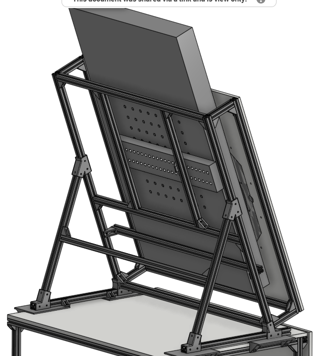

Yes, looking at it like this it's clear. And seeing this picture also reminded me that there's the TV mount part 😯. Obviously the back frame isn't just a square; there are several more supports. Two straight 44 cm pieces are installed in the middle (I picked the positions at random; I think each is 20 cm from its side). A 40 cm wide VESA mount goes on these. Again, first put slide-in nuts into the extrusion, then fasten the mount with screws plus washers. For the TV, install the two pieces that come with the VESA mount (they have to be mounted vertically), hang the TV on it, and fix the two together with long screws.

Again this is abstract. I'll put in pictures in the build log below.

## Circuitry and Firmware
This part is built on mai_pico. The main component is a Raspberry Pi Pico, the microcontroller that drives the whole device. The circuits needed aren't hard, but there are a lot of them.

For touch I use the mpr121 mentioned earlier, which is a common choice for touch in this kind of cabinet project. It communicates over I2C, and each chip has 12 touch points to which you can solder wires leading to copper foil or ITO to detect touch. Speaking of copper foil, I seriously recommend looking at my other project, [ESP32-Chunithm-Controller🤓☝️](https://github.com/samuelhsieh0829/esp32-chunithm-controller/blob/main/README-TW.md). By the way, I heard the yield of these chips isn't high. I didn't run into that, but they're only NT$36 each, so I suggest buying several extras as spares. I bought five at once.

The original mai_pico uses three mpr121s. maimai has 34 zones, and three mpr121s give 12 × 3 = 36, which is enough. But I heard four are more stable and also make it easier to divide up the zones, so in the end I decided to modify mai_pico's code to support my four mpr121s, and made my own fork. (I'll admit here that all the code was generated by gpt-5.6-sol, so if it breaks it's obviously not my fault 😯)

Speaking of making a fork, I also had the AI build a tuning interface, which is quite handy. It lets you edit the trigger threshold of each zone in a GUI and see the touch state of every zone. See [this one (samuelhsieh0829/mai_pico)](https://github.com/samuelhsieh0829/mai_pico).

Back to the circuit. Every tutorial I saw recommends using interference-resistant cable for high-speed data like the mpr121's. Honestly I don't know how much of a difference it makes, but the cable has to loop around the whole circle, over two meters in total, so that design seems reasonable. So I also bought three meters of "microphone cable" at Guanghua. Basically, look for one with four wires inside, surrounded by a braided metal mesh and filler, with a super-thick rubber jacket. Or you can search for "shielded cable" (there are plenty on Shopee, but they're all long-lead-time stock, which is too late for me). I have to say it really is expensive: about 7 meters of 4-pin cable cost me NT$140, while three meters of this shielded cable costs NT$240, which honestly made me cry, and it's quite a hassle to use too... Okay, enough complaining. There's one more thing about the mpr121 that every tutorial stresses: **cut the hidden trace on the back at the ADDR pin**. The I2C address of the mpr121 is determined by which pin the ADDR pin is shorted to, and **the default is GND**. If you don't cut it, **every mpr121 uses the same address, and they will definitely conflict**. So I suggest preparing each mpr121 this way as soon as you get it, and then jumpering each one manually to decide its address.

Next, the buttons. These include the eight buttons plus four extra ones: the 1P button in the middle of the cabinet, the coin button (yes — if you've been to Y19, where every 10 plays earns you 1 free play, the staff open up the cabinet and press a button inside to add a credit for you), and Test and Service (maimai's settings menu). The eight buttons always use the VCC, OUTPUT, GND combination. Basically, 5V goes to eight 220-ohm resistors in parallel, and each resistor connects to the VCC of one of the 8 buttons. Then 3.3V goes through eight 5.1k-ohm resistors and is connected in parallel to a total of 8 GPIOs and the 8 OUTPUTs. Finally, all the GNDs are joined and connected back to the Pi Pico. For the other four buttons I used mechanical switches left over from building a keyboard, which is simpler: connect one of the two pins to GND and the other to a GPIO. This uses the Pi Pico's built-in pull-up resistors (pins defined with INPUT_PULLUP in the code).

Then the WS2812. As mentioned earlier, the LEDs of every button are chained together, and in theory you could chain them into a ring, roughly like this (captured from [this link](https://memeprod.ap-south-1.linodeobjects.com/user-template/b4796eabe6cbdb1e4914edace86a69ec.png)): 

Obviously you'll need to separate one IN from one OUT. I used button 4 as IN, going 3 -> 2 -> 1 -> 8 -> ... -> 5 all the way around. Button 4's IN port has 5V, D, and GND. D connects to the Pico as the data input, and GND also connects to the Pico's GND so that D forms a loop. You could of course also connect 5V to the Pico's VCC, but to avoid starving the Pico of voltage, I chose to bring VCC and GND out to a separate pin header, and provide external power through a DC power jack.

A few other things to watch out for:
- Don't use Dupont wires. My experience with them back in my middle-school days wasn't good, and some articles also say not to.
- Find the energy to design a PCB. Hand-making a circuit board is exhausting; with 8 buttons, every kind of circuit has to be built 8 times, which is terrifying.
- Add a 0.1 uF and a 10 uF capacitor next to the Pi Pico. I heard they help a lot.

## Summary
So that finishes all the concepts you need for building a controller. The most important things you need are:
- Buttons and bezels. I suggest buying them ready-made on Taobao.
- ITO touch film. I also suggest buying it from Taobao.
- Plywood front panel, custom-made at a local woodworking shop.
- Aluminum extrusion. Just order the lengths you want on Shopee and have them cut it for you.
- A 43-inch monitor. If you're just fooling around, you can find a second-hand one at a used TV shop. If you want to splurge, look for 120 Hz (the official cabinet is only 60 Hz, for reference).
- Raspberry Pi Pico. If you're interested in rewriting the firmware, you could try an ESP32. Other options use a SAMD21, and you could also try an Arduino Pro Micro (but the Arduino's clock speed is low in theory, so I don't really recommend it).

Here's another picture I analyzed last year while researching controllers, although at that time there was still a lot I hadn't figured out
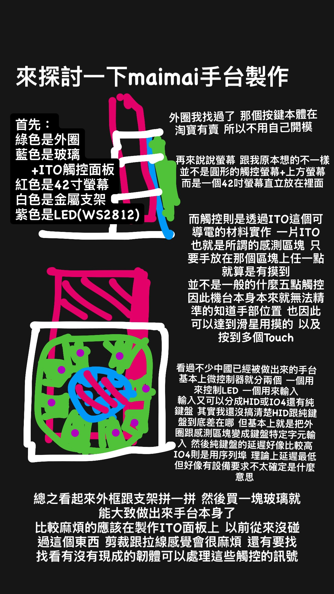

## Design Drawings
First, the design drawing of the front panel, i.e. what that 80 × 80 cm square actually looks like (although you've already seen the real thing above).
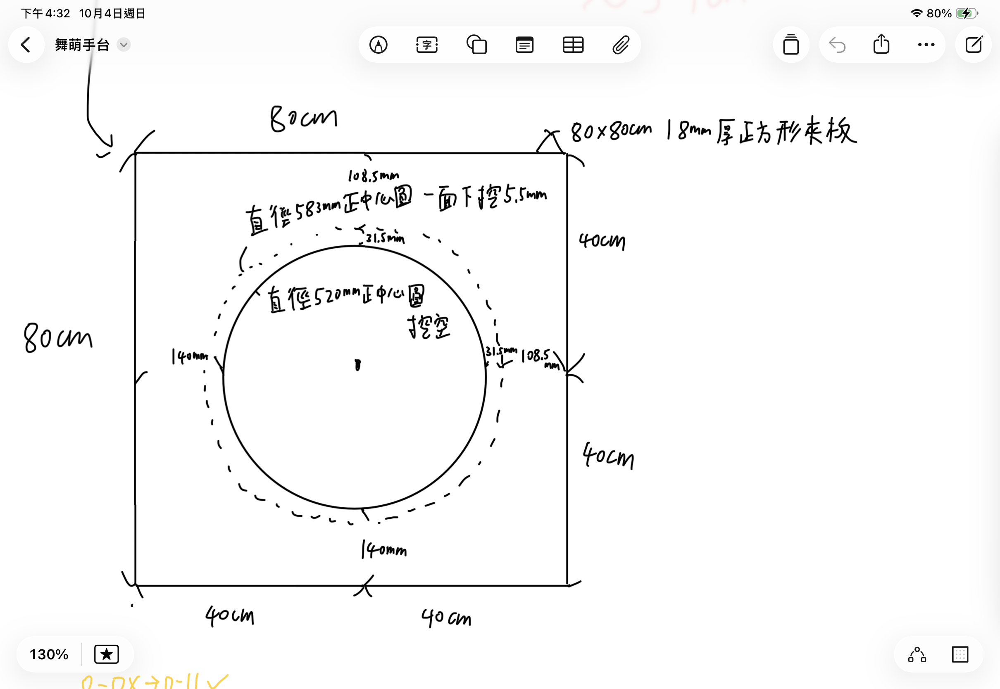

Combined with the glass it looks roughly like this. I ended up not using the glass clamps, so you can ignore them; I used L-shaped metal brackets instead. Also, the 12 holes (the drawing shows 10, but I ended up making 12) on the sides of this plywood were drilled later with an electric drill, to fix the plywood onto the aluminum extrusion.
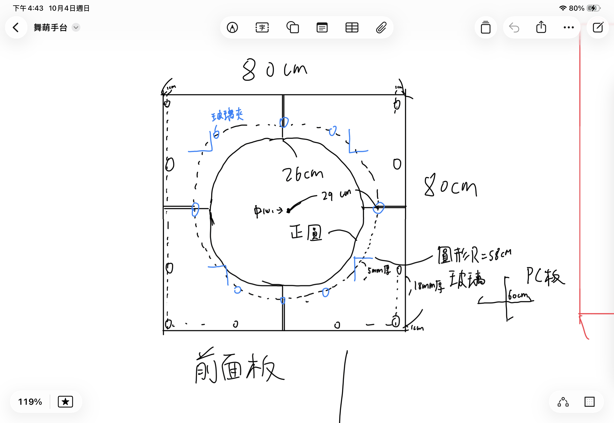

Then the wiring diagram, which only shows the most basic concept, so just give it a quick look.
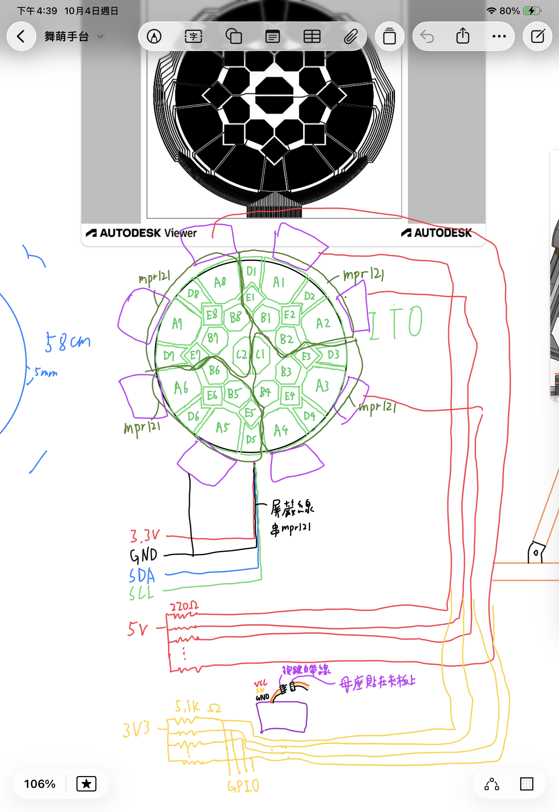

Next, the frame. It's basically a screenshot of that CAD file, but I added the length of each extrusion on top.
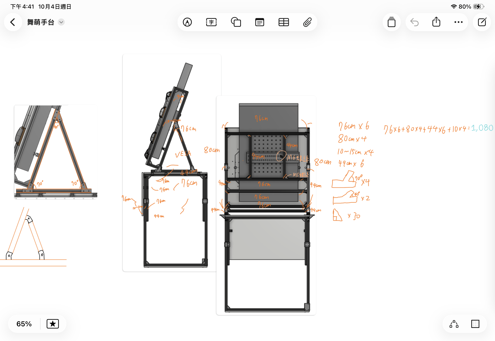


# Parts List
First, what I bought on Taobao:
|Item|Spec|Price|Notes|
|---|---|---|---|
|Outer-ring buttons|Complete unit x8|CNY 720|
|Bezels|x8|CNY 180|I overpaid ==|
|ITO conductive film|0.188 mm, 40 ohm, 1 m^2|CNY 210|

About NT$5,500 in total, including shipping

Next, what I bought on Shopee:
|Item|Spec|Price|Notes|
|---|---|---|---|
|2020 black V-slot aluminum extrusion|1,080 cm total|NT$1,836|Exact lengths x quantities are written below the table
|2020 aluminum extrusion rubber end caps|x4|NT$20|
|Black 2020 pivot hinge with handle|x6|NT$372|Make sure to find the type with 2 protrusions on one side (for mounting in the extrusion slot) and 4 on the other (for mounting on the end of the extrusion)|
|L-shaped corner brackets|x30, with set screws|NT$450|
|M5 slide-in T-slot nuts|x16|NT$64|For fixing the front panel and the VESA mount|
|M6 slide-in T-slot nuts|x6|NT$36|For fixing the hinges|
|Double-sided conductive copper foil tape|5 mm, 30 m long|NT$45|
|mpr121|x5|NT$180|
|2.8 mm male/female quick connector set|4P|NT$33|For connecting the shielded cable of the mpr121s to the main board
|1.25 mm wire-to-wire connector cable|3P, male and female x8 each|NT$96|For connecting the WS2812s. Not recommended, the wires are too thin|
|WS2812, waterproof|60/m, 1 m|NT$110|Left over from a 5 m roll I bought long ago, so I just used it :D|

The exact aluminum extrusion lengths used are as follows:
`10*4 + 44*6 + 76*6 + 80*4 = 1080(cm)`

Then what I bought at Guanghua Digital Plaza:
|Item|Spec|Price|Notes|
|---|---|---|---|
|Raspberry Pi Pico|-|NT$209
|5.1K ohm resistors|x10|-|I forgot the price, it's not much anyway
|0.1 uF capacitors|a few|-|I think I bought quite a lot
|1 uF capacitors|a few|-|But I seem to have used only one 0.1 + 10 uF set
|10 uF capacitors|a few|-|Also forgot the price
|Enameled wire|0.13 mm|NT$70
|Microphone cable|3 m|NT$240
|4P cable|7 m|NT$140|For the outer-ring buttons and the WS2812. Only 3P is really needed, but that doesn't exist
|Some kind of 3P male cable|x8|NT$96|For extending the outer-ring button cables, soldered to the 4P cable above
|Another kind (maybe the same kind) of 3P female cable|x8|Probably NT$96 too|Converts the 4P back to a 3P female
|That kind of 3P male base|x8|-|Connects the outer-ring buttons to the circuit board
|Also a 4P female cable + male base|x1|-|For the WS2812
|A very small 2P|x1|-|For connecting the DC jack
|DC jack|x1|-|Powers the WS2812
|DC power adapter|25 W, 5V 5A|NT$400?|Bought a while ago, just reused it
|Perfboard|A size that looked right|A price that looked right|Looked pretty good
|Tap|M5|Maybe close to NT$100|For cutting threads into the end of the aluminum extrusion; can be used with an electric screwdriver
|Multi-core wire|A bunch|Can't work it out|At least that's how I connected my mpr121s to the copper foil

Then what I bought at Xiaobei
|Item|Spec|Price|Notes|
|---|---|---|---|
|Stainless steel self-tapping screws (large flat head)|#8*1/2 x3 boxes|Forgot|For fastening the button bases onto the plywood
|Sleeves + screws|Forgot, about 1.8 cm long?|Forgot|For mounting the bezels
|L-shaped brackets with screws|Smallest size, 4 pieces total|Forgot|Hold the glass in place after it's set in the plywood recess
|EVA foam pads|One pack|Not much|Cushion for the glass|

The main event
|Item|Spec|Price|Notes|
|---|---|---|---|
|TV|Used Philips 43-inch|NT$3,000|I feel like I got ripped off a bit|
|Remote control|Probably some no-name brand|NT$300|This probably cost the owner zero, damn|
|VESA mount|Damn, even the box was torn. No-name brand|NT$500|One for NT$300 on Shopee would probably have been better|
|Tempered glass|58 cm diameter, 5 mm thick|NT$600|The most generous price of the whole lot. Jiansheng Glass (建生玻璃行) highly recommended|
|Plywood|1.7 cm thick, 80*80 cm, 52 cm diameter hole cut out, 58.3 cm diameter recess 5.5 mm deep|NT$2,000|Still expensive, but better than one shop that quoted NT$3,000 outright

And the screws
|Type|Length|Quantity|
|---|---|---|
|M5|10L|x8|
|M5|25L|x12|
|M6|35L|x2|
|M6|30L|x2|
|M6|16L|x2|
|M6|10L|x2|

There may be quite a few more screws I bought at Guanghua, but I forgot. Basically, M6 is for fastening the TV and the hinges. The hinge ones should be short; for the TV it depends on the TV itself. In theory the VESA mount comes with enough screws, but I figure not everything in this world follows theory = =. Anyway, this part is for reference only; you'll have to think for yourself and look at the materials you actually receive.

**Also remember to buy M5 and M6 washers**, and for the M6 ones, find some small enough to go on the hinges.

Let me tell you a story. I originally found the TV on Shopee. The listing said to chat first to ask about stock, and the guy replied with a freaking question mark. I had no idea what that question mark was supposed to mean. Then he told me to just contact him by phone. The original unit was only NT$2,800, but I foolishly told him my budget was NT$3,000, and from then on all his offers were NT$3,000 = =. Then he told me to come see it at his physical store. Seeing the unit in person is better anyway, but when he brought one out, my dad and I noticed the color quality was terrible, so I had him bring out a different one, which was better. Then there's the VESA mount, which was seriously terrible: the box was physically torn, and I don't understand how anyone dares to sell this for NT$500. But I didn't want to wait for online shopping again at that point, so I grudgingly settled for it @@

Finally, building this thing requires nimble hands, enough time and stamina, and a BOSCH power drill professional set. Rent one, or do what I did and spend a bit over NT$4,000 at Costco to take one home.

Okay, let me also list the tools you need to supply yourself. Some of these you may already have at home, and some you may need to buy separately

|Item|Purpose|
|---|---|
|Soldering iron|A soldering tool, I think everyone knows this one|
|Solder|Consumable for soldering|
|Hex key|The L-shaped screwdriver-like kind, used to open the outer-ring buttons and to tighten set screws|
|Screwdriver|Screws need tightening in lots of places|
|Electric drill|The plywood needs holes drilled. If you can, buy one that accepts screwdriver bits, which saves a lot of effort|
|HDMI cable|Just thought of it, but surely nobody lacks one (?|


The items above with a clear price add up to NT$16,393. Adding about NT$374 for a reasonable estimate of screws and other parts, the total cost of the cabinet is about NT$16,767 ~~yes 6767🗣️6️⃣🔽7️⃣🔼~~. Extra tools may cost more on top of that. If this price of nearly twenty thousand doesn't scare you off... wouldn't you at least consider a ready-made controller for a bit over NT$30,000? The quality may be 100 times better...

Are you a DIY person? Then let's get started!

# Build Log
What follows is basically a record of my whole process building the controller. It also includes some small details I missed earlier that are worth noting.
## 2026/8/16 Ordering materials
There's really not much to say here, but let's call it the first day the whole project was put into action. I originally wanted to include screenshots of the online orders, but thinking about it, they're not sponsoring me, so that would just be free advertising. If you want the details, DM me on IG.

Anyway, on day one I took care of the Taobao purchases plus the aluminum extrusion and hinges, since I expected these to take the longest to deliver.

But thinking again, I should still include a picture, so here's cute little Kanade eating cold-water cup noodles that day (●'◡'●)


## 2026/8/18 Buying the TV
I think I got up too late the day before, so I ended up pulling an all-nighter that day, and I think I held out for 30 hours 💀. In the morning I invited leaf to play mai. At noon I thought I'd go see @jky_7 and the others, but mickliu didn't come, so I went with them to see Spider-Man in his place. In the evening I wandered around a bit and then went to eat at Momo Paradise. I never slept through all of this because I had arranged to meet that guy at 8 PM that day to buy the TV.
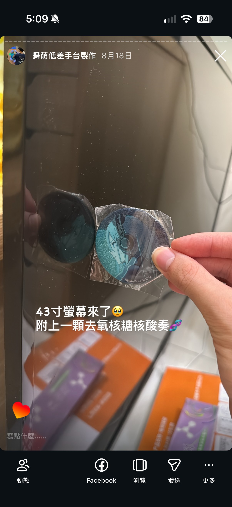

## 2026/8/19 The aluminum extrusion arrives
Unexpectedly, the aluminum extrusion was processed super fast: it arrived just three days later, so I jumped right in and started building the frame.
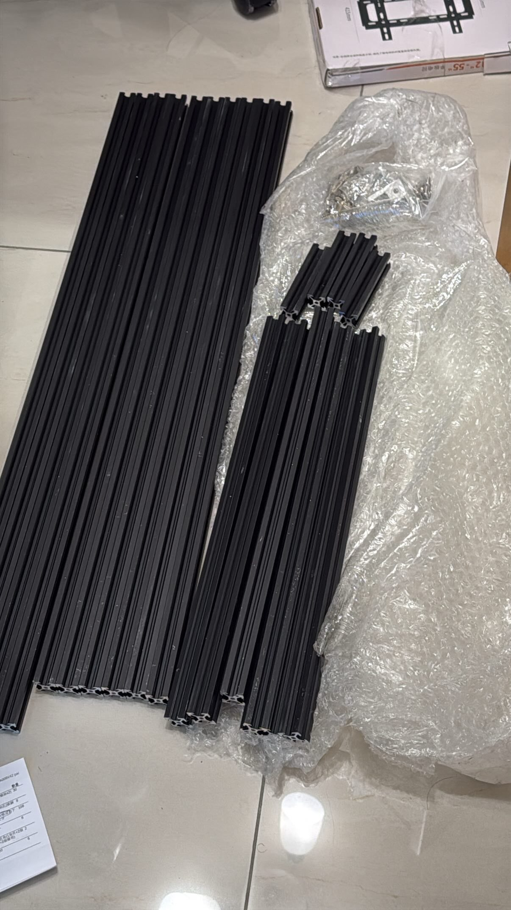
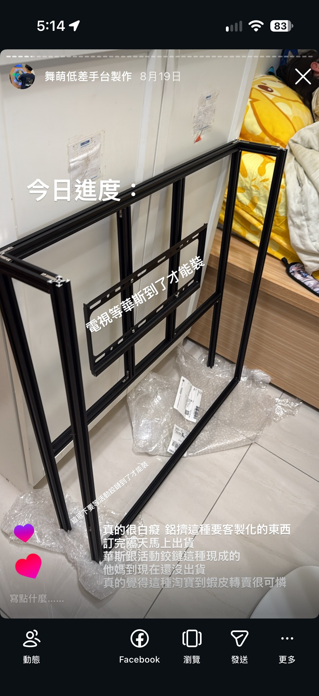
The funny part is that this TV mount needs washers, and I forgot to buy them, but then I dug up a bunch from a cabinet at home.

## 2026/8/21 Mounting the TV on the frame
Yeah, anyway, once I found I had washers, I mounted the TV first, though I actually took it off again later. I assembled it just to show everyone what it looks like.
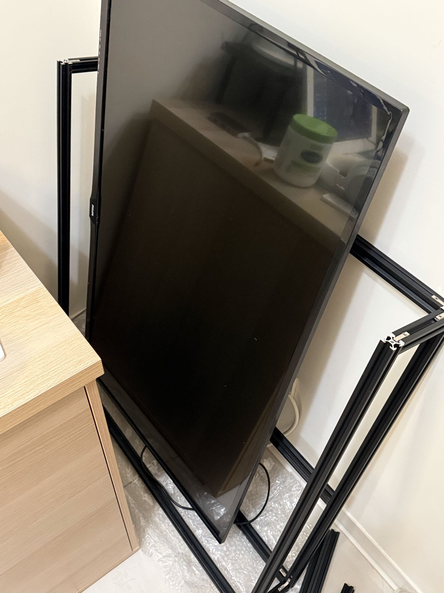
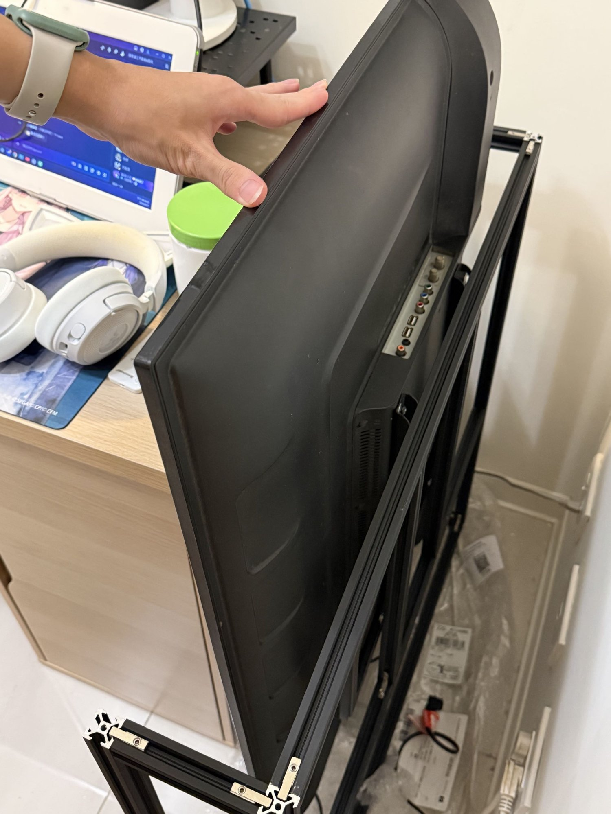

## 2026/8/23 Glass
Although I have no photos, I want to talk about ordering the glass. First, what we need is definitely **toughened glass** or **tempered glass**; ordinary glass won't do, or it might shatter just from playing or taking things apart. In my original plan I actually considered an acrylic sheet (I forgot which material), but when I re-read the document above I found someone mentioned that *acrylic is strictly forbidden for full-size cabinets*, so I dropped the idea. The good news is that glass isn't actually expensive. For my 58 cm diameter, 5 mm thick glass, there were three shapes at different prices when I bought it. One is a square, which I think was a bit over NT$400. The second is the circle I went with, at NT$600. The third is the regular octagon that most people in those documents use. The glass shop owner classified it as a special shape, for which you need to draw a blueprint for them to process, and I think that would cost over a thousand. Basically, a circle is plenty.

## 2026/8/24 ???
I didn't do anything much that day, so I was on voice chat watching Niulai (牛來) with friends (?
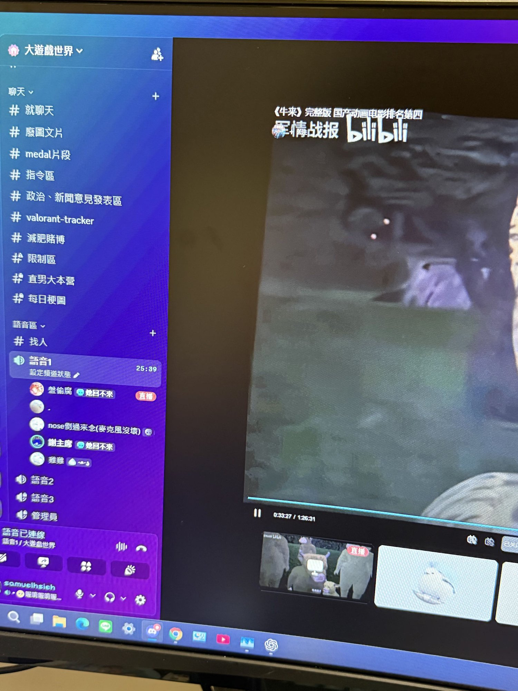

## 2026/8/26 Delivery day
Almost everything arrived this day: the glass, buttons, bezels, and ITO
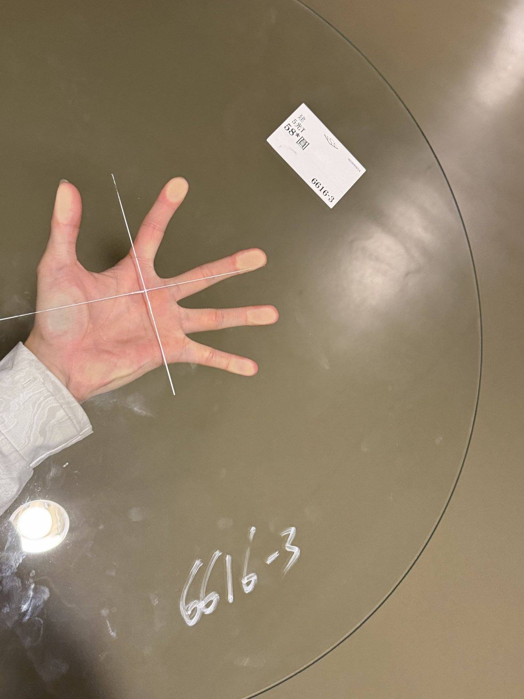
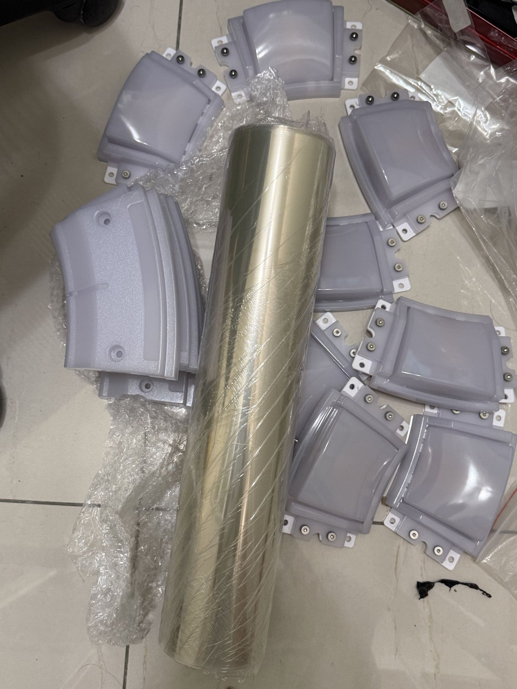

Looks like some kind of mysterious ritual
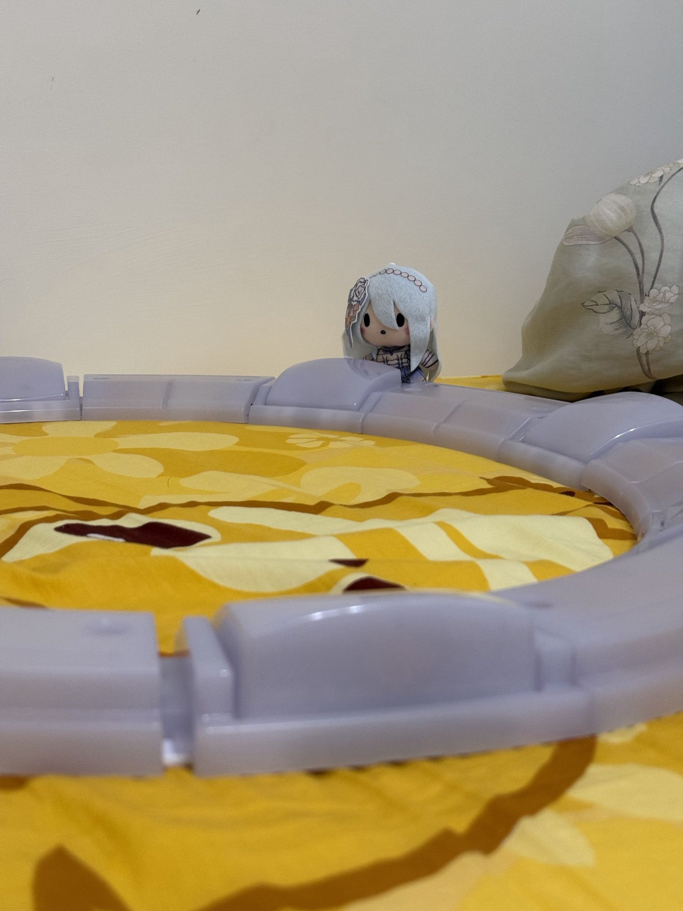

## 2026/8/27 Buying the plywood, ITO...
First, in the small hours of that day I was playing with the ITO. I mentioned earlier why you shouldn't stick a whole sheet of ITO onto the glass:
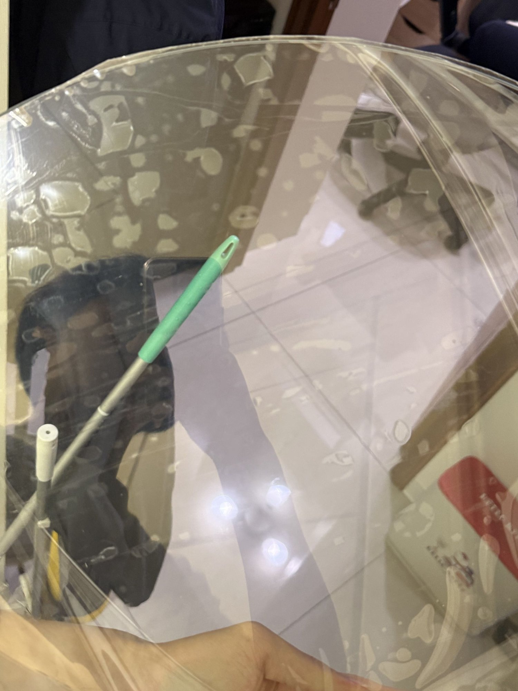
It's all bubbles, and the ITO's adhesive is ridiculously sticky, so the bubbles basically can't be squeezed out. This approach is clearly not something one person can do.

Then the plywood. The owner of that lumber shop was very nice. I showed him the design drawing right there, and he said he could make it on the spot. After paying, I walked around the neighborhood and scrolled on my phone, and in an hour it was done. It was probably the most efficient item of the whole shopping trip :D Oh, and after buying it, remember to ask your mom to call an Uber to take it home.

Next was cutting the ITO. Anyway, following the files I linked somewhere above, cut the ITO into all these shapes. Those files, once printed, look something like this (taken from the files in [this link](https://github.com/Syndric/maimai-controller-fullsize/blob/master/dxf/mai_pico_a4.zip)):
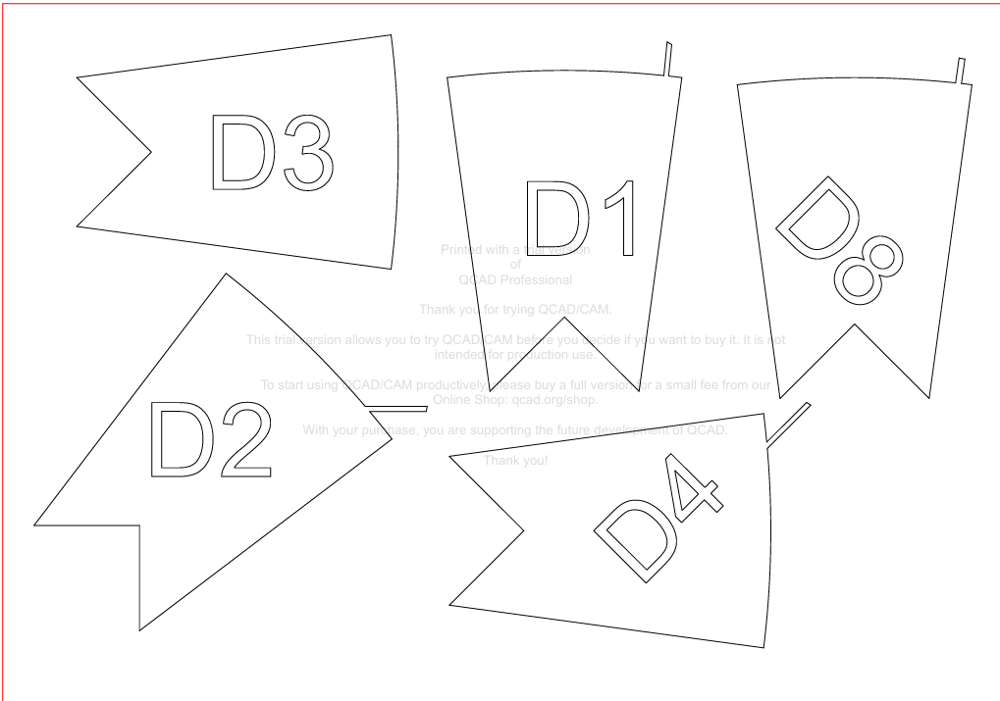

Print them out first and cut the patterns out of the paper. It'll look roughly like this:
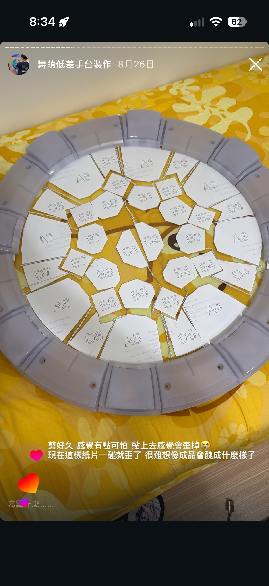

Place these paper templates on the ITO one by one and cut the ITO into the same shapes. One thing to watch out for here:

Brand-new ITO has two sides that are easy to tell apart. One is the conductive layer, characterized by an easily peeled plastic protective film stuck on it. The other is the adhesive layer, where you have to pick at the edge to peel the film off. `When cutting, the front of the paper template (the side with printing) must be against the **conductive layer of the ITO**`, otherwise you'll get a mirrored ITO.

Then open your maimai game and go into test mode, where there's a sensor setting. Lay the glass on the screen lying flat, mark the positions on the glass with a marker, and then stick the ITO on. ~~Yeah, at least that's what I did, but it wasn't a smooth process and a lot of pieces ended up crooked. You can look for a better way. I've heard of printing a full-size poster and putting it underneath to line things up~~

## 2026/8/29 Inner ring wiring done, and also...


Holy crap, still rushing the build on my **18th birthday**, amazing. I originally thought some good friends would invite me out, ~~but I have no friends~~ okay, someone did invite me, but at the time I felt like I should spend it with family, so I didn't go out that day. Also, I pulled another all-nighter and worked until 11 AM, wanted to rest for a bit, and the moment I lay down on the bed it was 5 PM 🫠

Anyway, in the small hours of that day I finished sticking all the ITO on. The result looks like this:
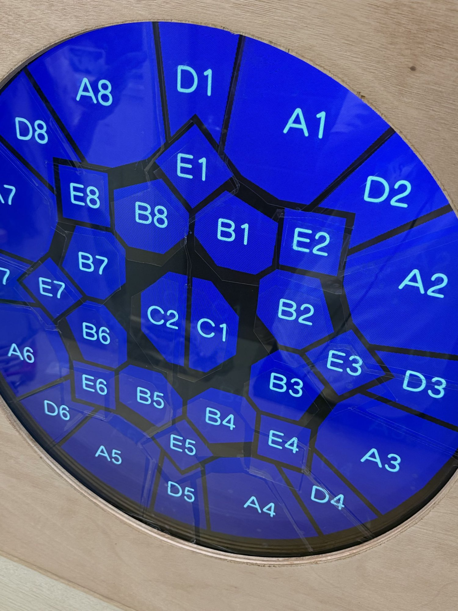
Some spots are still a bit crooked, which I'll deal with later. Anyway, I assumed at the time that all of these would work (yes, I used the leads-from-ITO method). Next, at the places where the ITO leads out, I stuck on copper foil tape and then soldered wires to connect it to the mpr121.
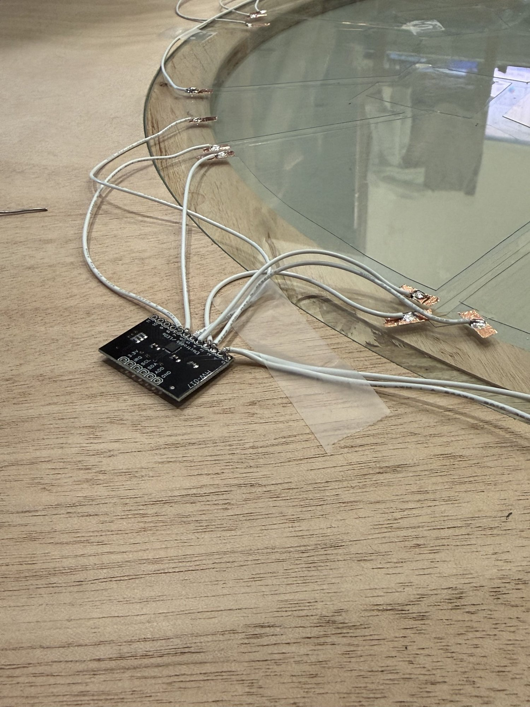 I split them into four mpr121s by number: 1,2 / 3,4 / 5,6 / 7,8. Which electrode on the mpr each zone connects to is up to you; this can be changed later in the software.

Next is handling the shielded cable (the microphone cable). It has to daisy-chain the four mpr121s around the circle. My approach was to start with the 3,4 mpr121 and solder the cable's conductors directly onto it, then run the cable all the way to near 1,2 and cut it, re-solder the two cut ends together, and solder on an extra multi-core wire to connect to the mpr121.
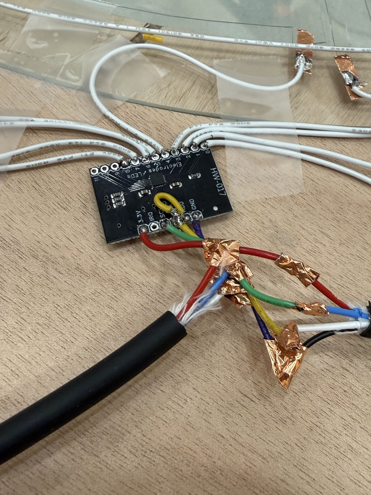

Repeat this, and finally pull the cable out at 5,6, and solder a 2.8 mm connector (if I remember correctly that's the name) onto the end of the cable, to mate with the identical connector on the main board. I didn't photograph this connector, but the final overall routing looks like this:
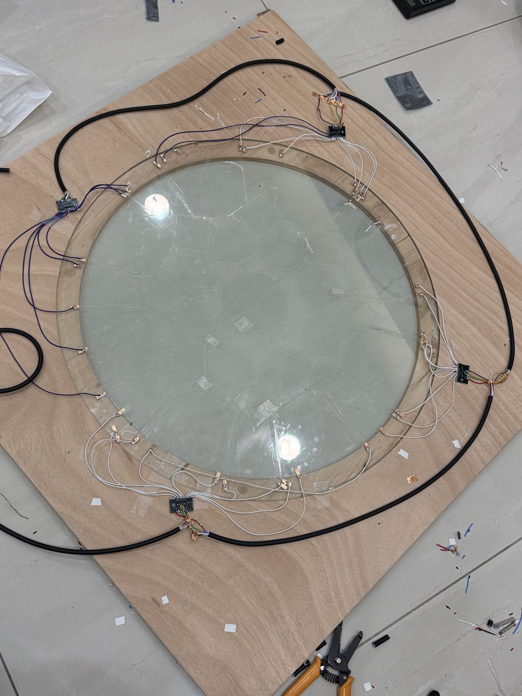

Besides the inner-ring stuff, that day I also started on the outer-ring buttons. I took the buttons apart with a hex screwdriver, plugged in the photo eye cables, stuck on the WS2812, and soldered on the IN and OUT wires. That's about it. Remember that the WS2812 IN and OUT directions must be consistent in every button, and IN must always correspond to the female connector and OUT to the male one (swapping them also works). Anyway, make sure every button is done the same way, so that the lighting of all the buttons can be chained together correctly.
 Showing the picture from before once more for reference

## 2026/8/30 Barbecue at Mobe's place 😴
Sunday is the day of rest, so I should take a break (?

A reminder: remember to find cable ties with 3M adhesive backing to secure the shielded cable. Otherwise that cable is heavy, and one day it might rip the mpr121 off.

Also, don't wire the shielded cable carelessly. I thought I'd use single-sided copper foil tape as isolation, but I really didn't figure out when this stuff conducts and when it doesn't, and the I2C got shorted. It took me a long time to track down = =
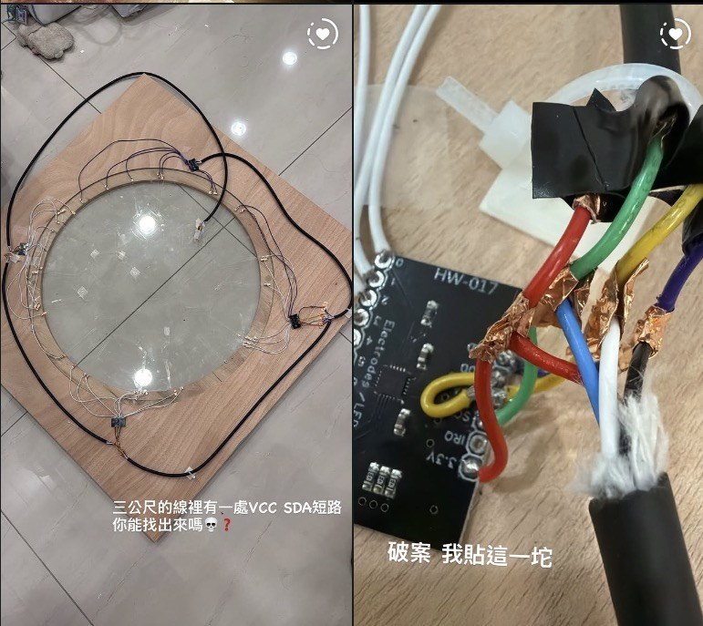

## 2026/8/31 Front panel assembly
I had just finished all the glass and ITO wiring, but up to this point the glass hadn't been fixed in place. In the current state the glass lies flat on the floor in the plywood's recess. For this you need to go to Xiaobei and buy L-shaped metal pieces + sharp-thread screws. The corner that sticks out at the L's right angle serves as a stopper for the glass, and the holes on the L are screwed into the plywood. Unluckily I didn't take a photo of this, but when I show the fully finished front panel later you can look again and you'll roughly see what the L is.

Anyway, once the glass is secured you can flip the panel back to the front and start mounting the outer ring. To align the outer-ring buttons correctly, the easiest way is to just place the buttons directly above the A zones of the screen, arrange the bezels in place too, and pre-form a complete circle. Then line up the inward-facing edge of each button with the round edge of the plywood, and the positions will be about right. Use a pencil to mark circles on the plywood through the small holes on the four sides of each outer-ring button, then line up the wood self-tapping screws and screw the outer ring on. At the same time, a hole must be drilled between every pair of buttons so that the buttons' own cables can run to the back.

Alright, that was a bit abstract to explain, so here's a video:
[](https://youtu.be/8zCHP77YaYo)

Marking circles with a pencil looks like this
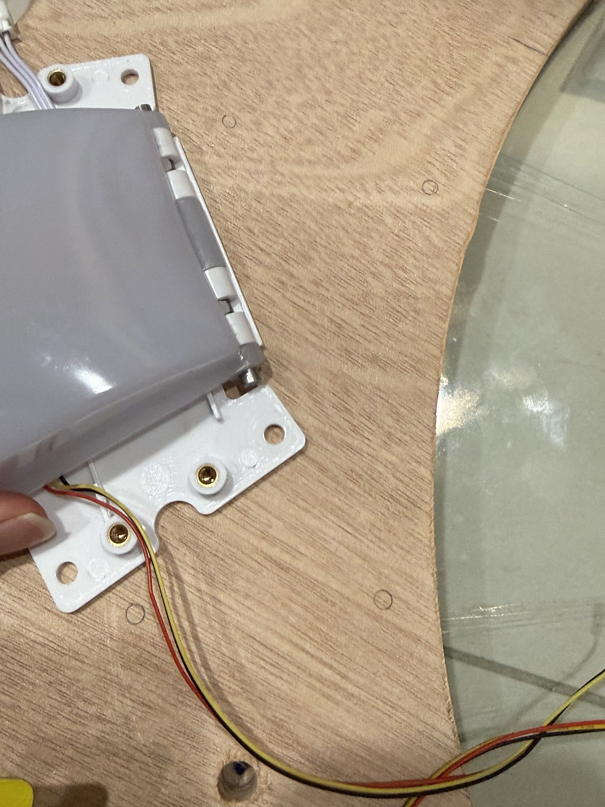

With everything installed it looks roughly like this. Note that I installed them without the top covers on, but that shouldn't matter.
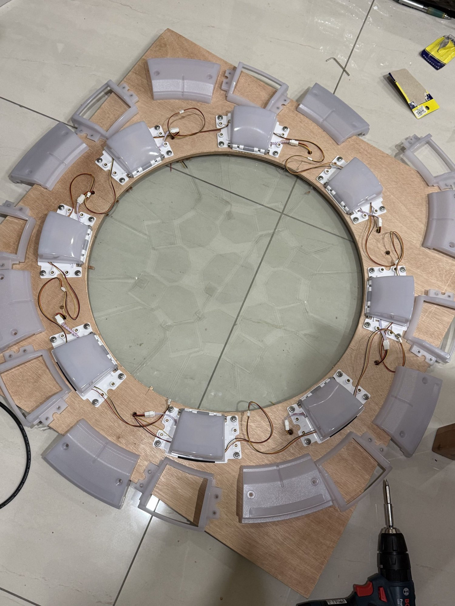
A close-up
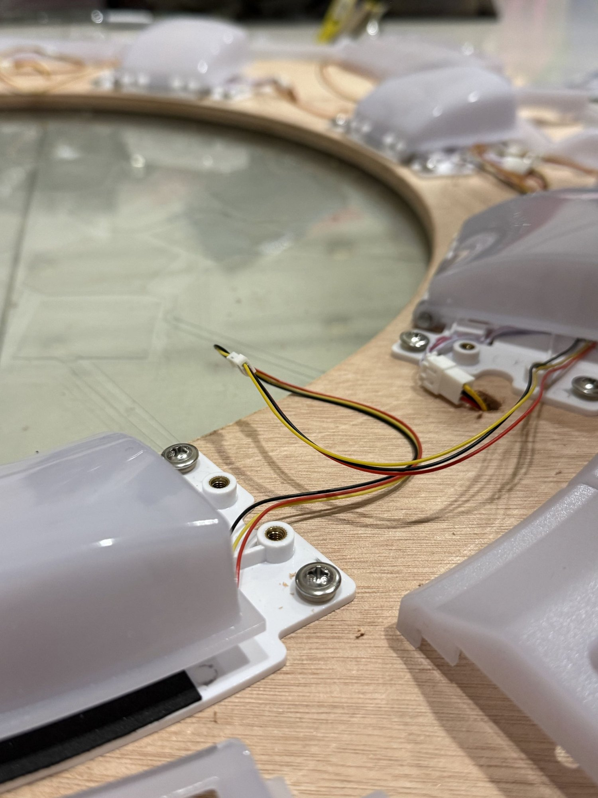

## 2025/9/1 I feel like you don't really care about me as a friend
Huh?


What does that even mean. Well, okay, I was also at fault hhhh

Then in the afternoon I organized a 4-player mai session, which was nice.

If you dare to pry, I'll consider telling you.

## 2026/9/1 Wiring the buttons
Don't you think this soldering iron is being a little flirty with me (?
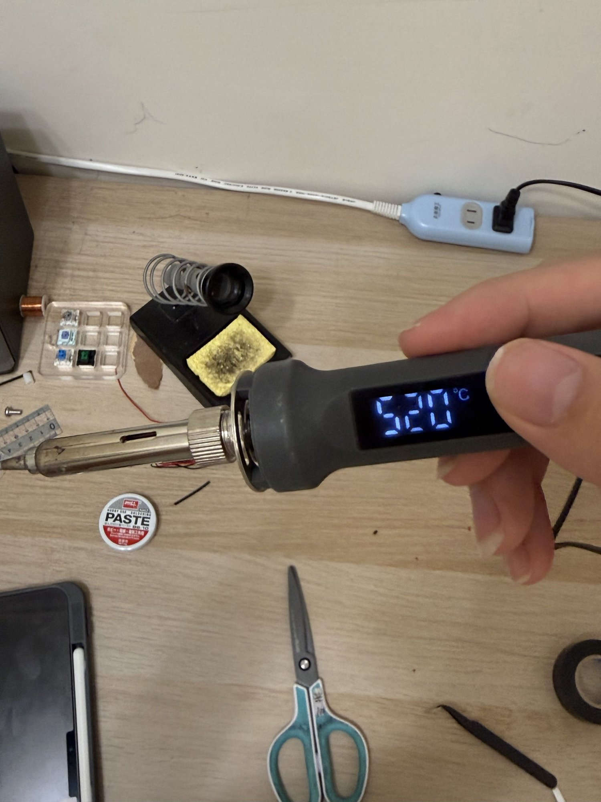

Anyway, this day I soldered up that whole pile of wires on the back. Remember the 3P connector cables and the 7 meters of 4P cable in my parts list? These are for extending the outer-ring cables. First, connect a male connector onto the cable extending from the button, then solder on the 4P cable, and cut the 4P cable to a suitable length so it's long enough to reach the circuit board on the floor. If you used cable ties earlier to bundle the mpr121 cable, you can tuck these in too. Finally, solder a female connector cable onto the end of the cable.

The WS2812 is the same. Once the outer ring is chained together on the front, pull out the IN of the bottom-most LED and connect its own 4P cable, extend it out as before, and solder on the female connector. Worth noting: I deliberately used 4P connectors here, both to tell the lighting cable apart from the 3P button cables, and because the motherboard's ARGB header uses the same 4P format, so it serves as a kind of identification.

A little secret fact: the WS2812 is fully compatible with the ARGB on a motherboard. That is, after buying this kind of LED strip yourself, you can connect 5V, DATA, and GND to the corresponding positions on the motherboard and use it directly. This kind of header takes up the width of 4 pins, but looks like `1101`, with one position missing a pin, as a kind of foolproofing (?

Anyway, when done it looks roughly like this
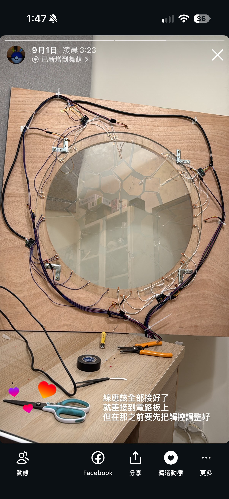
You should also be able to see the L-shaped metal brackets I mentioned earlier in this picture.

## 2026/9/2 Making the main board
Who would believe I spent an entire night turning a perfboard into an exquisite PCB; every time I look at it I think it's the masterpiece of the century.
First, picture one: my mysterious wiring. This part supplies power for the pull-up resistors to the button sockets. The resistor legs are chained together mysteriously to pass 3.3V all the way down. I have to say I still find this chaining work crazy; the way the resistors sit on the surface looks really pretty.
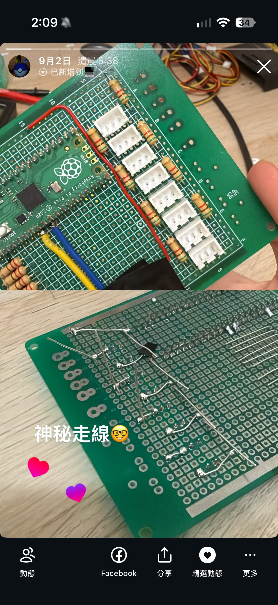

Then the rest of the wiring. Anyway, just solder multi-core wire on the back, and so on and so on. Let's just look at the finished product:
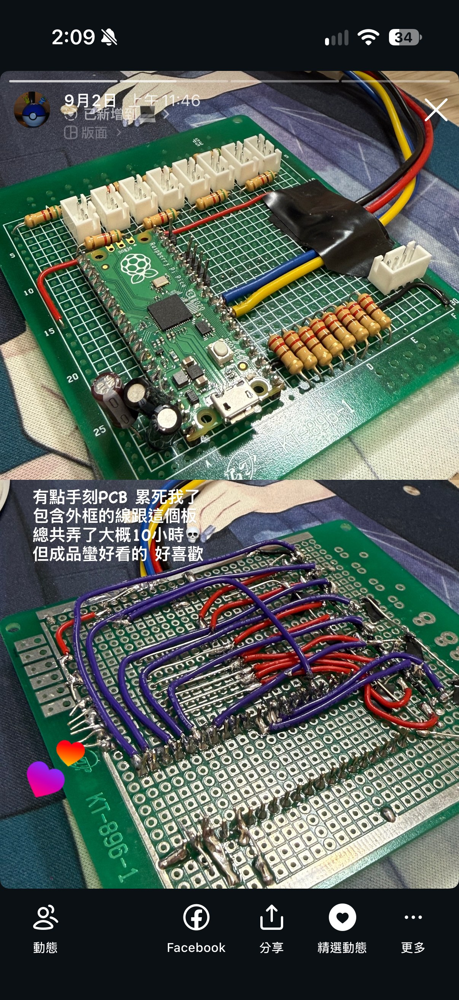

Let me explain this picture. First, those eight 3P male headers are for installing the buttons. Each has a GND, all chained together; an OUTPUT, connected to a 5.1k resistor and a purple wire on the back; and, visible on the front, the eight 220-ohm resistors for the 5V power VCC. Next to them there's also a 4P male header for installing the WS2812. Some parts aren't visible here because I installed external DC power. The wiring here should still be 5V straight from USB; I'll supplement this with a hand-drawn circuit diagram below. The thick red, blue, yellow, and black wires are the 2.8 mm connectors, used to connect the mpr121s. On the front you can also see five extra pins (it may not be obvious, they're on the right of the Pi Pico), used to install the other four buttons: four GPIO inputs and one GND.

Drawn as a diagram, it would look roughly like the picture below. As for how the traces end up looking, that depends on your wiring skills.
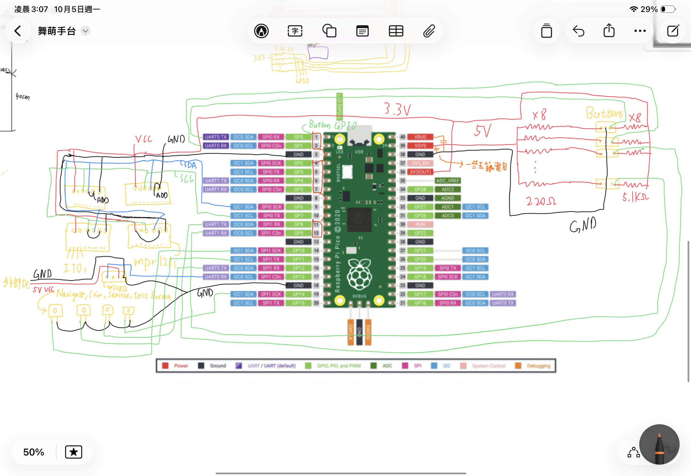

I also had Claude make a [WIRING.md](WIRING.md) for reference, but it's not entirely accurate. Also, a reminder again: the sockets for the 8 buttons, the positions the buttons connect to, and the GPIOs of the four function buttons don't need to strictly follow the numbers in the table, as long as they're within the corresponding range (the eight buttons on GPIO 0~9 except 6 and 7; the four function buttons on 10, 11, 12, and 14). Plug them in anywhere within that range, since it can all be changed later. 6 and 7 are reserved for the mpr121's SDA and SCL, and 13 is for the WS2812's IN.

This project doesn't install any lighting other than the button lighting, such as cabinet lights or Aime lights, and it doesn't install an Aime card reader either. If you plan to install lighting, continue the chain after the OUT of the last button LED. The Aime reader would be chained on the same I2C line as the shielded cable.

Finally, use a multimeter to check for shorts everywhere. Once everything is fine, you can plug in the inner- and outer-ring cables for testing.

## 2026/9/3 Firmware and device debugging
As mentioned earlier, I use 4 mpr121s, which isn't compatible with the original mai_pico project, so I asked Codex to write a new version of the firmware. I also had it build an HTML visual configuration page that helps adjust which mpr121 pin each ITO zone maps to and which GPIO each outer-ring button maps to. In addition, it can change the WS2812 LED count and order (each of my buttons has 4 LEDs, versus 2 originally, and the order is 43218765). For the code, see
https://github.com/samuelhsieh0829/mai_pico

Below is the complete firmware workflow, from getting the files to finishing the setup. Just follow it once, start to finish.

### Firmware Walkthrough
Overall flow: check the hardware → get the code → flash the UF2 → launch the configurator → connect → assign touch zones and buttons → save → set up the lighting → verify

#### 0. Before you start
- A Raspberry Pi Pico, and a USB cable that **carries data** (a charge-only cable means your computer won't see the Pico at all)
- Chrome or Edge. The configurator connects through Web Serial, which Firefox and Safari don't support
- Node.js (npm comes with it), from https://nodejs.org . If you don't know how to install it, ask Codex or Claude Code to do it for you :D
- Git (optional). Without it you can just click Download ZIP on GitHub
- Hardware to double-check:
  - The SDA of all mpr121s goes to GPIO6, SCL to GPIO7, and the WS2812 data line to GPIO13
  - The GPIOs for the buttons can only be `0 1 2 3 4 5 8 9 10 11 12 14`. 6 and 7 are taken by I2C and 13 by the LEDs, and the firmware won't let you pick anything else
  - **The four mpr121s must have different I2C addresses.** The firmware looks for exactly these four:

|mpr121|ADDR pin connected to|I2C address|Number in the configurator|
|---|---|---|---|
|1st|GND|0x5A|MPR 0|
|2nd|3.3V|0x5B|MPR 1|
|3rd|SDA|0x5C|MPR 2|
|4th|SCL|0x5D|MPR 3|

A new mpr121 module ships with a thin default trace between ADDR and GND. For the 2nd to 4th modules you must cut it with a knife first, then wire ADDR to the pin in the table above. The 1st module can stay on GND. "1st, 2nd..." is only the address numbering; it doesn't mean a module has to sit on any particular side of the ITO. Each ITO zone can go to any electrode on any module, and you assign them in the configurator later.

#### 1. Get the code
```bash
git clone https://github.com/samuelhsieh0829/mai_pico.git
```
Or click Code → Download ZIP on the GitHub page and unzip it. What you'll use in the folder:

|Path|Purpose|
|---|---|
|`firmware/mai_pico.uf2`|**The latest firmware. Flash this one**|
|`configurator/`|The web configurator|
|`firmware/mai_pico-20260905-inputfix1.uf2`, `inputfix2.uf2`|Historical builds from 9/5, with `.sha256` checksum files|
|`firmware_test_versions_20260918/`|Four builds I made on 9/18 to compare touch detection methods; includes its own notes. You normally don't need them|
|`Production/firmware/mai_pico.uf2`|An older build (8/29), not recommended|
|`firmware/INPUT_FIX_NOTES.md`, `INPUT_FIX2_NOTES.md`|Details of the input fixes and how to read the diagnostic output|

#### 2. Flash the firmware
1. Unplug the Pico's USB
2. **Hold down the BOOTSEL button on the Pico** while plugging the USB into your computer
3. A drive named `RPI-RP2` appears; you can release the button now
4. Drag `firmware/mai_pico.uf2` onto that drive
5. When the copy finishes the Pico reboots by itself and the drive disappears. That means it worked. You don't need to wait for any "done" message or eject anything

To update the firmware later you don't need to touch BOOTSEL again. Type `update` in the configurator's "Advanced Terminal" tab (or in any serial terminal), and the Pico reboots into `RPI-RP2` mode on its own; then drag in the new UF2.

If things behave strangely after switching versions, the old saved settings may not suit the new firmware. You can type `factory` to reset everything to defaults, then replug. **This wipes all your custom settings**, so first press "Download JSON" (下載 JSON) in the configurator to back them up.

#### 3. Launch the configurator
The configurator lives in the `configurator` folder. It's a web page that runs on your own computer, with no internet connection or backend needed.

**The first time**, install its packages. Open a terminal (PowerShell or cmd) and run:
```bash
cd "C:\{your file path}\mai_pico\configurator"
npm install
```
After that, **on Windows you can just double-click `configurator\start-local.cmd`**, which starts a local site at `http://127.0.0.1:5173/`. To start it from the command line instead:
```bash
npm run dev
```
Then open http://127.0.0.1:5173/ in Chrome or Edge.

Notes:
- Keep that terminal window **open** while using the page; closing it stops the site
- If it complains that port 5173 is already in use, you probably already have one running. Use that one, or close the old one first
- If PowerShell says "npm.ps1 cannot be loaded because running scripts is disabled on this system", replace `npm` with `npm.cmd` in the command. That's exactly what `start-local.cmd` does

#### 4. Connect
1. Make sure the Pico is plugged in and no other program (such as another serial terminal) is holding its COM port
2. Click "Connect Command Line Port" (連接 Command Line Port) at the top of the page
3. The browser shows a serial port picker. This firmware creates **four COM ports** (Command Line, Touch, LED, AIME). Each port shows its name in the picker; pick the **Command Line Port**
4. If you pick the wrong one, the page fails to connect because it gets no reply to `cfg info`; just pick another. If you can't tell which is which, connect to one with any serial terminal and type `whoami`: the Command Line, Touch and LED ports each report who they are
5. If the picker is empty, click "Show all serial ports" (顯示所有通訊埠) to remove the filter. If it's still empty, try Edge, to tell whether it's a Chrome problem or Windows not recognizing the device

Once connected, the top of the page shows "Connected" (已連線), and the status panel on the right should read **`4 / 4 ONLINE` for MPR121 and `0x0f` for Sensor mask**. If it shows CHECK or another value, one of the mpr121s wasn't detected. Go back and check that module's I2C wiring, SDA/SCL, power, and whether ADDR is wired as in the table above.

#### 5. The live status tab (checking your wiring)
After connecting you land on the "Live status" (即時狀態) tab, which shows the state of all **34 touch zones** and **12 buttons** at 25 times per second.

- Touch each ITO zone on the glass one by one and check that the same zone lights up on screen
- Tick "Show Δ / current threshold" (顯示 Δ／目前門檻) to see each zone's reading (Δ = baseline − filtered, which rises when touched). It helps you spot zones that respond too weakly or jitter
- Press every outer-ring button, plus 1P, coin, Test and Service, and check that the right one lights up
- This tab is observation only. It doesn't pause game input, AIME or lighting, so you can leave it open while playing

A freshly flashed firmware is at factory defaults: only three mpr121s have zones assigned and the fourth has none, so **with four modules, plenty of zones will be wrong at first**. That's expected, and the next step fixes it.

#### 6. The mapping tab (the most important step)
Switch to the "Mapping" (分配設定) tab. The fields show the values currently stored in the Pico's flash, and **every edit is only a draft on screen** until you press "Save all" (全部保存). The top right shows how many edits are unsaved.

**Touch mapping (34 zones).** Each zone has these fields:
- **MPR**: 0 to 3, i.e. which mpr121 the zone is connected to (the numbering from the address table above)
- **ID**: 0 to 11, i.e. which electrode on that module (ELE0 to ELE11 as printed on the mpr121)
- **Press Δ≥** and **Release Δ<**: the zone's press and release thresholds. A zone counts as pressed once Δ goes above the press threshold, and only counts as released after Δ falls below the release threshold. The gap between the two prevents flickering at the edge
- If you pick an MPR + ID already used by another zone, the page **swaps** the two, so the draft is always one-to-one and two zones never share an electrode

How do you know which ITO zone is on which electrode? Two ways:
1. Fill it in directly from your own wiring notes
2. Go to "Advanced Terminal" and type `touch`: **touch an ITO zone with one hand and hold it, and press send with the other** (or ask someone to press it). It reports the triggered electrode, e.g. `Touched: E3 (Sensor 0, Electrode 1, press >= ..., release < ...)`. The zone name at the front (E3 here) comes from the old, not-yet-changed mapping, so ignore it and look only at Sensor and Electrode. Careful! The `Electrode` shown here **counts from 1**, while the ID in the configurator and the `touch` set command **count from 0**, so Sensor 0, Electrode 1 means MPR 0, ID 0. Then assign the zone you actually touched (say A1) to that MPR + ID

I split mine across the four mpr121s by number, 1,2 / 3,4 / 5,6 / 7,8, so A1, B1, A2, B2... were simply filled in in order. Also, the `raw` command lists the MPR:electrode, reading and thresholds of all 34 zones at once, which is handy for cross-checking.

**Button mapping (12).** That's the eight outer-ring buttons plus Test, Service, Navigate (the 1P select button) and Coin:
- **GPIO**: only the pins the firmware allows are listed, and picking an occupied one also swaps
- **Active level**: whether the pin is LOW or HIGH when pressed. The firmware default is LOW (internal pull-up, the switch connects to GND when pressed), which is what my four mechanical-switch function buttons use. Whether the outer-ring optical buttons are inverted depends on how you wired them: **press one and watch the live tab; if it lights up when not pressed and goes dark when pressed, the polarity is reversed**, so flip Active level. This option switches as a group (the eight ring buttons are one group, the four function buttons another)

The default GPIO assignment is `1 0 4 5 8 9 3 2` for ring buttons B1 to B8, and 12 / 11 / 10 / 14 for Test / Service / Navigate / Coin. You don't have to follow it: plug into any pin on the allowed list and change the mapping here to match what you actually wired.

**Saving.** When you're done, press "Save all" at the bottom. It first pauses live monitoring, writes the 34 zone mappings and 12 button mappings to flash as one transaction, reads them back to compare, and only counts as success if they match; then it resumes monitoring on its own. Game input is briefly paused during saving, which is normal. If the page highlights any errors (for example unreasonable thresholds), fix them first, or saving is blocked.

There are also:
- "Discard changes" (放棄修改): throw away the draft and go back to what the device currently has
- "Download JSON" (下載 JSON): save the current settings as a backup file (`mai-pico-hardware-profile` format)
- "Import JSON" (匯入 JSON): load a backup file as a draft. You still need to press "Save all" to write it. **Once you're happy with everything, I strongly recommend downloading a JSON**, so you can import it right back after `factory`, a firmware change, or a board swap

Important: if you close the page or unplug USB before saving, the whole draft is lost.

#### 7. Lighting and other settings (Advanced Terminal)
These are set with commands. Type them in the "Advanced Terminal" tab, or connect to the Command Line Port with a web serial terminal such as https://googlechromelabs.github.io/serial-terminal/ . Typing `?` lists all commands.

My lighting as an example (the brightness `128` is just an example; adjust to your power supply and taste):
```
rgb 4 0 0
level 128
save
```
- `rgb <LEDs per button> <LEDs per cabinet-light node> <LEDs for banner>`: I have 4 LEDs per button and no cabinet lights or banner, so it's `rgb 4 0 0`. A count of 0 ignores that node. The Aime light is fixed at 16 LEDs and can't be changed; it doesn't matter if you didn't install a reader
- `level <0-255>`: brightness. Lower it if you have lots of LEDs or a weak power supply
- The chain order of the LEDs (4→3→2→1→8→7→6→5) is hard-coded in the firmware source as `RGB_BUTTON_MAP` in `firmware/src/board_defs.h`, so **it can't be changed with a command**. Mine happens to match the default, so I didn't touch it. If you chained yours differently, edit that array and rebuild the firmware yourself
- `save`: most commands are saved automatically a few seconds after you change something, but to be safe type `save` once afterwards to write immediately

Other commonly used commands:

|Command|Purpose|
|---|---|
|`display [rgb\|sense\|hid\|gpio\|touch\|aime\|tweak]`|Show the current settings; with no argument it shows everything|
|`touch`|With no arguments = detect the zone currently being touched and its electrode|
|`touch <sensor 0-3> <electrode 0-11> <zone>`|Set a mapping directly, e.g. `touch 1 9 E6`; zone `XX` means not connected|
|`gpio main <8 GPIOs>`|Set the eight ring buttons, e.g. `gpio main 1 0 4 5 8 9 3 2`|
|`gpio <test\|service\|navigate\|coin> <GPIO>`|Set a single function button|
|`gpio reset`|Restore all GPIOs to default|
|`tweak main_button_active_high <on\|off>`|Ring button polarity (on = HIGH when pressed)|
|`tweak aux_button_active_high <on\|off>`|Function button polarity|
|`hid <io4\|key1\|key2\|off>`|How button presses are sent to the PC; see below|
|`sense [zone\|*] <+\|-\|0>`|Fine-tune sensitivity; with no zone it's global|
|`filter <first> <second> [interval]`|mpr121 noise filter parameters|
|`debounce <touch> [release]`|Touch debounce, 0 to 7|
|`raw`|List each zone's reading, baseline, Δ and thresholds|
|`stat [reset]`|Touch statistics|
|`cfg info`|Show the firmware version and device info|
|`cfg diag`|Print diagnostics, for troubleshooting|
|`whoami`|Make the Command Line, Touch and LED ports each report who they are|
|`aime mode <0\|1>`, `aime virtual <on\|off>`|Aime reader settings (not installed in this project)|
|`update`|Reboot into `RPI-RP2` mode to update the firmware|
|`factory`|Factory reset (wipes all custom settings)|

`hid` modes: the default `io4` sends the buttons to the game the IO4 way. `key1` uses keyboard input: the eight ring buttons are `W E D C X Z A Q` and select is `3`. `key2` is also keyboard but on the numpad: ring buttons `8 9 6 3 2 1 4 7` and select `*`. Both keyboard modes have `F1` = Test, `F2` = Service, `F3` = Coin. `off` sends no button input.

#### 8. Verification
1. Replug the USB and **keep your hands off the panel for about a second** so the mpr121s can finish initializing and calibrating their baselines. If your hand is on the glass at boot, the baseline is calibrated wrong and everything behaves oddly afterwards
2. Open the live tab, touch all 34 zones one by one and press all 12 buttons one by one, and confirm each is correct
3. Hold a zone and check that it stays pressed until you let go, and that it really returns to unpressed afterwards. If it still shows pressed after you let go, it's most likely the parasitic capacitance problem described earlier (leftover ITO, too much tape area)
4. In the Advanced Terminal type `cfg info` to confirm the firmware version, and save a copy of the `cfg diag` output as a baseline to compare against if something goes wrong later
5. If touch is off across the whole panel (for example your hand was on it at boot), **take your hand away first**, then **long-press the Coin button for 2 seconds**. This re-initializes touch and recalibrates the baseline
6. Hook it up to the game and play for a while, watching for missed inputs, auto-repeat, or stuck inputs

On the game side, if you use Sinmai, make sure `DummyTouchPanel` under `[AM]` in `mai2.ini` is set to `0` (use a real touch panel). According to the analysis in `firmware/INPUT_FIX2_NOTES.md`, with `1` (fake touch panel mode) the game handles touch state and counters separately, which can cause held touches to be cleared and spurious repeats. Back up the file before editing, and fully quit and restart the game for it to take effect. The `mai_pico/firmware` folder includes `apply_inputfix2_game.py`, which backs the file up and changes only that one value:
```bash
python firmware\apply_inputfix2_game.py --ini "D:\your game path\Package\mai2.ini"
```
Add `--verify-only` to check without changing anything. Also, Touch and LED are separate COM ports, so for the COM numbers you enter in the game launcher, use `whoami` to find out which port is which.

The diagnostic details (what each `cfg diag` field means, and how to tell whether a problem is in the chip, the firmware or the USB layer) are in `firmware/INPUT_FIX2_NOTES.md` inside mai_pico, for anyone who needs them.

#### 9. (Optional) Build the firmware yourself
Normally the prebuilt UF2 is enough. You only need to build it yourself to change the defaults (for example `BUTTON_DEF` for button GPIOs, `TOUCH_MAP` for the default touch mapping, or `RGB_BUTTON_MAP` for the LED chain order in `board_defs.h`). You need the Raspberry Pi Pico SDK, the Arm GNU embedded toolchain and CMake. I built with Pico SDK 2.3.0 and Arm GNU Toolchain 12.2.1, target board RP2040. Then run this in the `mai_pico` folder:
```bash
git submodule update --init --recursive
cmake -S firmware -B firmware/build -DPICO_SDK_PATH=<path to your pico-sdk>
cmake --build firmware/build
```
You get a new `mai_pico.uf2`, flashed the same way as above. The configurator's own tests and build can be run with `npm test` and `npm run build` in the `configurator` folder.

### Problems I ran into while debugging
With the firmware and configurator set up as above, problems showed up quickly: many ITO zones triggered without being touched, and others responded only slightly when pressed, or not at all. At this point I basically identified the issue with the ITO leads: the lead strips probably had too much resistance (cut too thin; R = kL/A, a very simple principle: the smaller the cross-section and the longer the length, the higher the resistance, and if the resistance is too high it may not conduct at all). So I started cutting off some of the lead strips and switching to enameled wire taped onto the ITO with clear tape, with the other end soldered to the copper foil that was originally stuck on for the ITO lead. Using copper wire largely solves this problem.

I recorded a video at the time describing the situation: [this one](assets/touch_bad.mov)

## 2026/9/4 Inner ring repair, bezel installation, frame installation
Sadly I didn't capture the bezel installation, but anyway that day I invited plumtofu to help me with this part. Basically, once the outer ring is all installed, you can drill straight into the semicircle beside each button and install the screw sleeves bought earlier. These sleeves have ridges on the sides so they bite firmly into the wood. After pressing the sleeve in, put on the bezel cover, line the screw up with the sleeve under the cover, and screw it in, and you're done.

At this point the whole controller is basically made, but before mounting it on the frame, the touch needs to be tuned properly, because once the front panel is attached to the frame it's very hard to touch this part again.

On 9/3 I had already noted the condition of each ITO zone: some barely responded to touch, some had numbers jittering randomly, some were stuck completely, and some moved two zones when touching one. Here are the conclusions I reached after troubleshooting at the time:
- When touching one moves two, the ITO leads are overlapping. That's just my terrible craftsmanship. Cut off one of them and use enameled wire instead, and that's it ~~or cut them all, enameled wire is more stable anyway~~
- A weak response is because the resistance is too high. For these, just cut off the ITO lead, **you must cut it off, I'll explain why in a moment**, and switch to enameled wire taped on + soldered.
- Random jitter is basically an open circuit. In that case, try touching the zone's connection to the mpr121's IO. If the number suddenly jumps up, it means the resistance at the lead really is too high, and the fix is the same as above.
- If the number is stuck, and touching the electrode on the mpr121 gives no response at all, a very common cause is that **it's shorted to the neighboring electrode**. I had several zones like this at the time, thought they were broken, and decided to use a different electrode (of course, it's possible that this kind of failure really exists). But the moment I desoldered the wire it was fine, so I concluded that the wire at the electrode had accidentally touched its neighbor and caused the abnormality.

Anyway, after this round of repairs everything was mostly fine... right? Touch was being sensed, but then a new problem started: after touching and letting go, the computer still showed a touch. Part of this is that the conduction path has too much extra material, causing **parasitic capacitance** (I think GPT said this, so it should be right). One source is leftover ITO, so **if you're not using the ITO as the lead, cut it off**. Another is **too much tape area on the enameled wire**, which is more random, since some of my zones were fine even with a large area. I went back and tidied this up on 2026/9/18, and reducing the tape area did effectively solve about 90% of this kind of problem, but some places still randomly have it, and I have no solution for that. Anyway, **when taping enameled wire, minimize the tape area**.

Alright, at this point the controller is truly complete. The last step is to build it into a real cabinet: the screen and the frame.

The plywood has 12 holes in total on the left, right, and bottom. In theory these holes should be centered 1 cm from the edge, with each edge divided into four equal parts. After drilling through these holes, lay the frame flat on the floor, and put four slide-in nuts into each of these three sides (if you've already put the frame together, unlucky bro, your bottom edge is probably blocked, so you have to take it apart to slide the nuts in lol, or maybe drop-in nuts could work). After roughly positioning them, screw the screws in from the top of the plywood. I didn't screw in all of them, because lining up the nuts is a real pain, and some tolerance from somewhere made the whole thing a bit crooked and impossible to line up. In the end I only got 9 done. At least it's been a month and it hasn't blown up, so it should be fine (?)

Current progress: it can stand upright. Actually you could probably play like this, but standing on 10 cm isn't very stable, so the angled braces still need to be added.
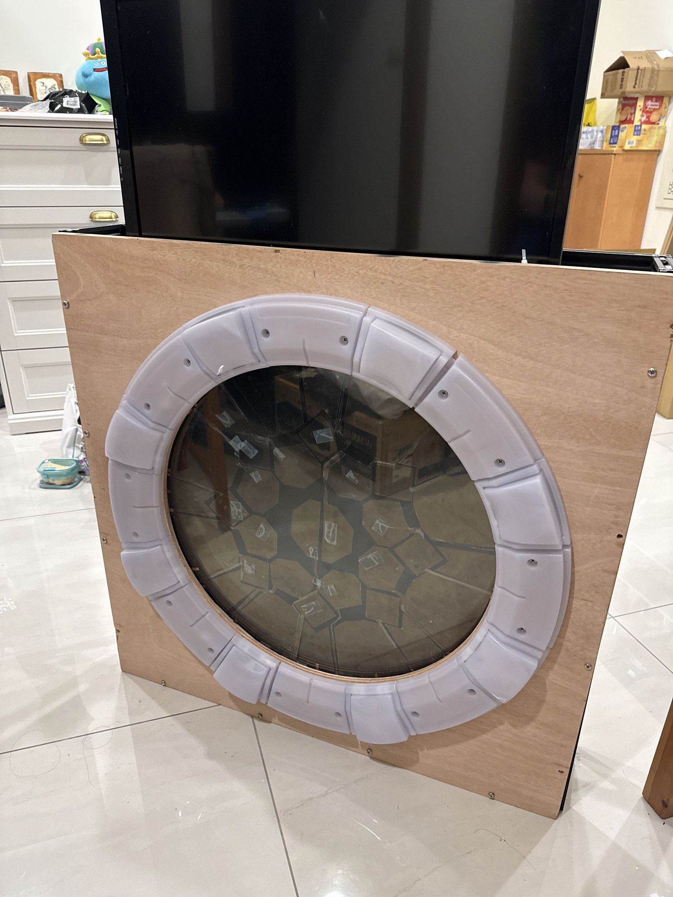

## 2026/9/5 Angled braces installed, done
The very last step is to install the back supports and the base. The pivot hinge can be split into two halves. One half is installed on the end of the extrusion (that 2 × 2 cm cross-section), and the other is fixed into the extrusion's slot with a slide-in nut and screw. To install on the end of the extrusion, you first need to cut screw threads into the round hole there, which takes an M5 tap. The one I bought came in three sizes, apparently each used at a different stage: you start with the biggest and gradually go finer. I don't really understand it, so someone experienced may be able to add to this. Anyway, the usage is to mount the tap on an electric drill, put a drop of lubricating oil in the hole, then drill in a bit and back out, a bit deeper and back out a little, deeper, out a little, in and out, in and out ~~so lewd~~, slowly working the thread in. Then repeat with the finer one, and finally try an M5 screw; as long as it screws in normally you're done. Places that need tapping: the two 44 cm angled-brace pieces, and the two 80 cm bottom pieces on the back of the frame.

After tapping, first take the last two remaining 44 cm pieces as the base. On one face of each, put in two **M6 slide-in nuts**, then fit end caps on both ends. Take the six hinges apart, and install four of them onto the base in the same orientation (parallel to the extrusion), with the large hole facing outward so it's easy to tighten with a wrench later. Repeat this step once on the 80 cm piece on the back of the frame, but don't tighten it down yet.

The 44 cm angled-brace pieces first need to be joined with the last 76 cm piece. For how to assemble them, refer to the design drawing; I won't elaborate.

This last step needs two people. To assemble all the pivot hinges, one person has to hold up the frame with the front panel, while the other tightens the six hinges. Of course, if you actually get to this step, there should be easier ways to do it. I kind of forgot how I did it at the time. Anyway, I worked with my mom, and turn turn turn, it was all done.

At this point the controller is completely finished 🥳. Give yourself a round of applause. Getting this far is really not easy. ~~And then you'll immediately realize you can't move this thing without two people.~~

Anyway, plug in the TV power cable and HDMI cable, the Pi Pico USB cable, and the external DC power supply, and start enjoying your free ~~NT$20,000~~ maimai!

Here are pictures of my finished build:

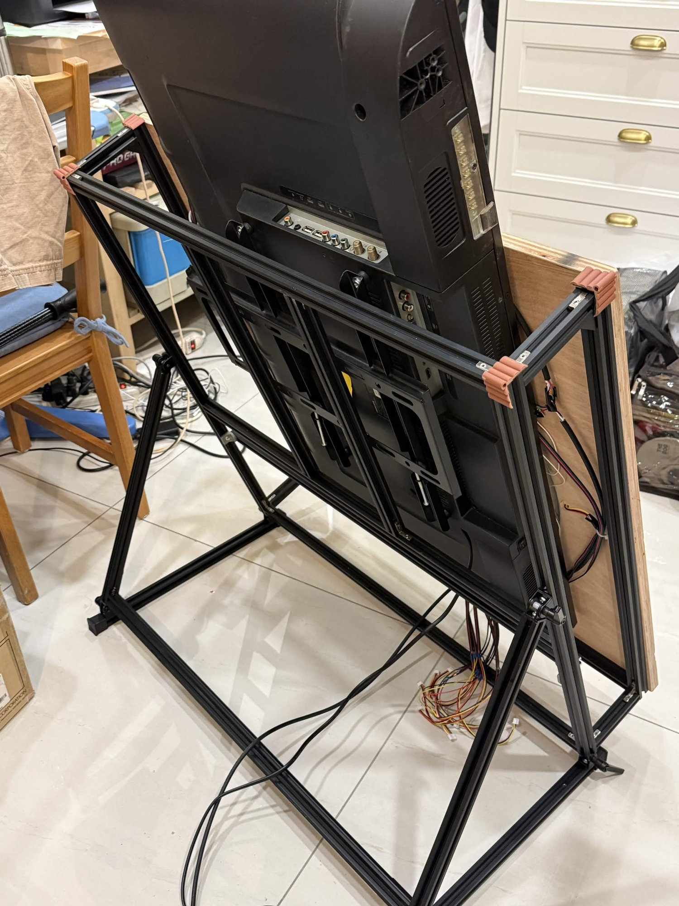
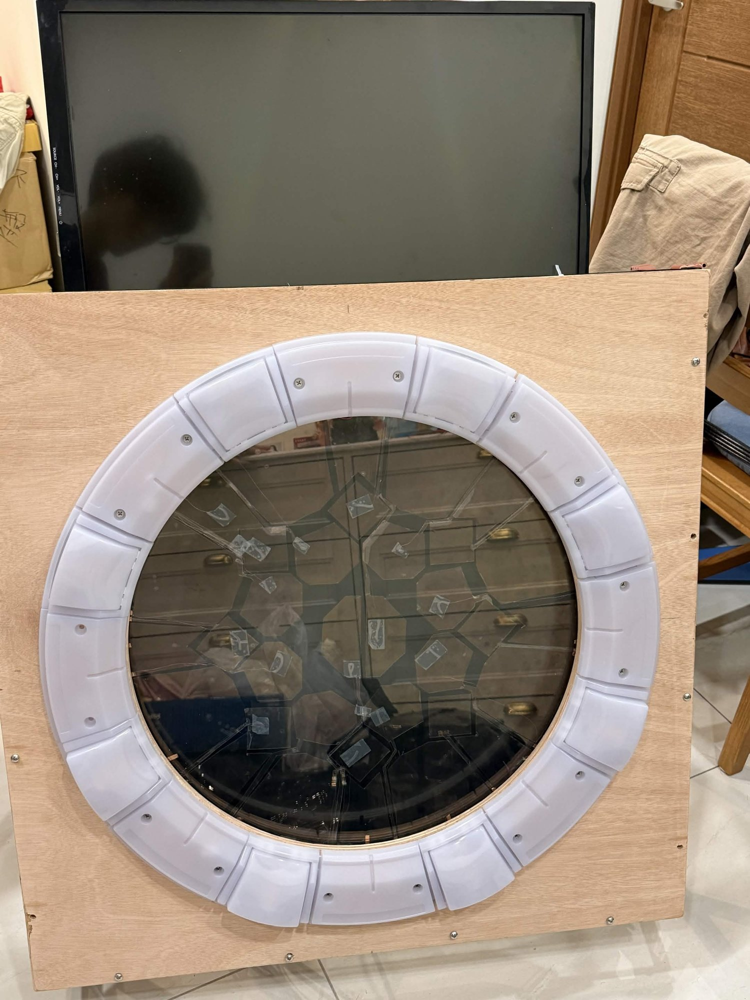
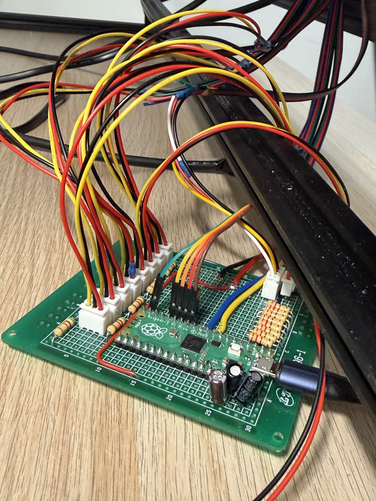
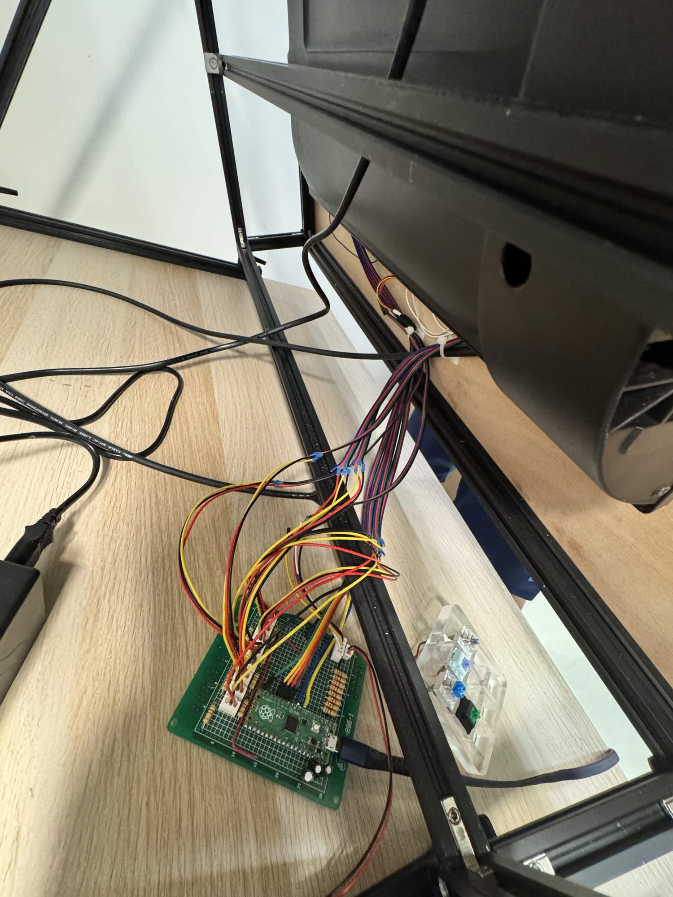

# Conclusion
After finishing this whole device, I have quite a few thoughts

First, the pitfalls I stepped into (or things worth emphasizing once more), organized directly into a list:

- Use enameled wire for the ITO leads from the start (again, only try the other way if you're confident in your craftsmanship, but confidence can be deceiving)
- Keep the tape area small, always
- Cut the mpr121's ADDR trace (everyone mentions this one)
- Don't trust the button wire colors
- Always use insulating tape to protect any wiring, **especially don't assume that copper foil tape resisting interference means it counts as insulation**
- The 1.25 mm connector wires are too thin and aren't suitable for a high-current device like the WS2812
- The plywood could be thinner than 1.7 cm
- The screw sleeves make it impossible to open the top covers, so find some other brass-standoff-like solution for fixing the bezel covers
- Assembling the frame first blocks the bottom edge for installing nuts. If you know somewhere will get blocked, put things in place beforehand

# Acknowledgments
- Thanks to Dad and Mom for being willing to sponsor this project
- Thanks to @plumtofu for coming to my place to help
- Thanks to @hyeee_820 for cooking me ramen on my birthday
- Thanks to ChatGPT for serving as my consultant
- Thanks to all the authors of the references, whose experience paved the way for a latecomer like me
- Thanks to myself for being willing to work hard T_T
